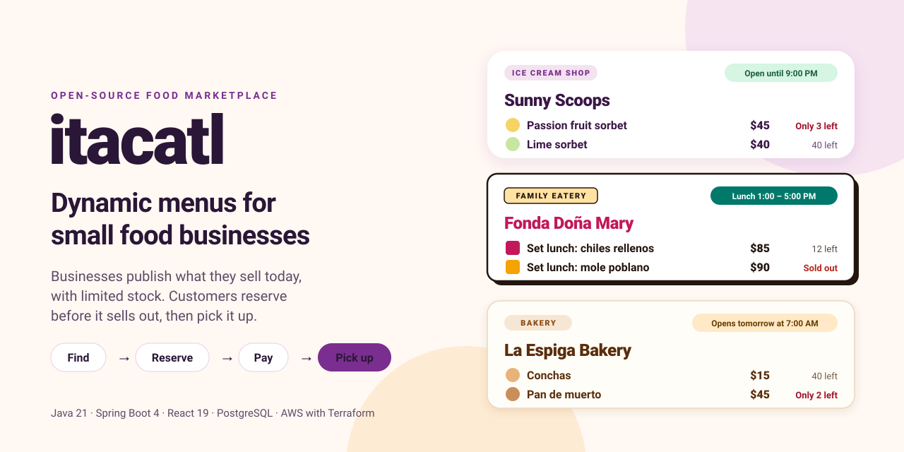
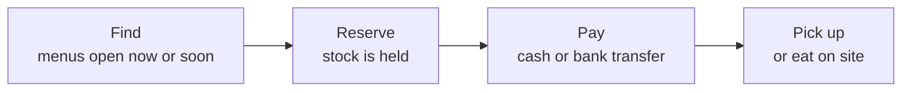
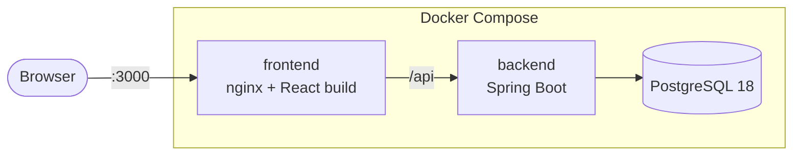
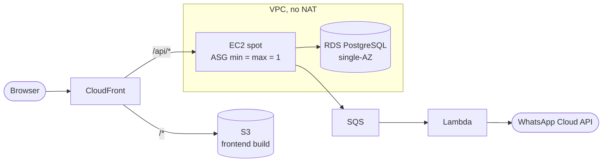

<p align="center">
  
</p>

<p align="center">
  <a href="https://github.com/landoicco/itacatl/actions/workflows/ci.yml"></a>
  <a href="LICENSE"></a>
</p>

**itacatl** is a marketplace where small food businesses publish **dynamic menus**: what they sell today, in a service window, with limited stock. Customers find what they want, reserve it before it sells out, and pick it up.

It is built for the way small Mexican businesses work (a *fonda*'s lunch of the day, an ice cream shop's rotating flavors, a bakery's seasonal bread), and every kind of business is configuration, not code.

> *Itacatl* is Nahuatl for the food you carry for the road, the root of the Mexican Spanish *itacate*.

## One platform, many verticals

One deployment is one marketplace for one kind of business; the demo is ice cream shops. A vertical is a theme, sample data, copy and a default language, so a new one needs no new screens ([theming guide](docs/theming.md)).

| Vertical | What its menu looks like | State |
|---|---|---|
| Ice cream shops (*neverías*) | Fixed flavors plus rotating ones, scoops in stock | ✅ Demo, `pastel` theme |
| Family eateries (*fondas*) | The *comida corrida* (set lunch) of the day | 🎨 `market` theme ready |
| Bakeries, coffee shops, *pulquerías*… | Bread of the day, seasonal specials, *curados* | 📋 Same model, a theme and a seed away |

## Status

A work in progress, built in the open.

| Milestone | State |
|---|---|
| PostgreSQL, CI, ruleset on `main`, hardened containers | ✅ Done |
| Internationalization (`en`, `es-MX`) | ✅ Done |
| Marketplace domain model and read API | ✅ Done |
| Customer UI: themes, phone and desktop layouts | ✅ Done |
| Owner and staff accounts: Spring Security, sessions in PostgreSQL | ✅ Done |
| Owner API: catalog, menu lifecycle, per-business permissions | ✅ Done |
| Owner panel: catalog and menu editor, mobile-first | ✅ Done |
| Tenant isolation, reservations and payments ([roadmap](docs/product-spec.md#rework-roadmap)) | 🚧 Next |
| Terraform: bootstrap, modules, CI/CD | 📋 Planned |
| Ephemeral AWS deploy with load test and recovery evidence | 📋 Planned |

## Try it

Requires Docker with Compose v2.

```shell
cp .env.example .env
docker compose up --build
```

Open `http://localhost:3000`. The backend seeds three sample ice cream shops with today's and tomorrow's menus, so there is always something open or about to open. The API runs at `http://localhost:8080`:

```shell
curl -s localhost:8080/api/businesses | jq
```

The seed also creates two demo accounts, `ana@example.com` (owner of two shops) and `luis@example.com` (owner of one, staff in another), both with the password `itacatl-demo`. Sign in with **For businesses** in the header to open the owner panel: build tomorrow's menu from the catalog, publish it, and see it on the marketplace. Luis sees Sunny Scoops read-only, as staff.

The database has no persistent volume, so data resets with `docker compose down`.

## Product



What makes it different from a generic store is that menus are **dynamic**: they belong to a service window and run out. Businesses keep a catalog of what they know how to make and publish a menu per service, with that day's price and stock ([domain model](docs/domain-model.md)).

## Built for translation

The codebase is in English; the first deployment serves Mexican users in Spanish. Internationalization is a design rule, not an afterthought:

- No hardcoded UI text: every string lives in a per-locale catalog, type-checked against English, and CI fails when a translation is missing.
- The API returns stable error codes ([RFC 9457 Problem Details](docs/domain-model.md#errors)) and local dates as data, so the client words them in the user's language.
- Prices, dates and times go through `Intl`, in each business's own time zone.
- Language, theme and sample data are chosen per deployment.

How it works: [i18n guide](docs/i18n.md).

## Architecture

### Local

Compose runs the same images that would run in AWS. nginx plays the role CloudFront has in production: it serves the frontend build and forwards `/api` on the same origin.



### AWS (planned)

A single low-cost production environment, deploy-ready but kept off: validated on every PR and applied only to capture evidence. Estimated at ~$25/month if left running. Design in [ADR 0002](docs/adr/0002-low-cost-production-architecture.md).



Layers, patterns and the rules that keep them: [architecture guide](docs/architecture.md).

## Engineering highlights

**Backend**
- **Tenant integrity in the schema:** composite foreign keys `(id, tenant_id)` make PostgreSQL reject any row that mixes two businesses, whatever the code does.
- **Deterministic time:** schedules are local times plus a zone ID, and "now" comes from an injected `Clock`, so opening hours are tested at a frozen moment.
- **No N+1:** the shop list loads every shop's hours and next menu in a fixed number of queries.
- **Real database in tests:** integration tests run against PostgreSQL in Testcontainers, which also validates every Flyway migration.
- **Sessions that survive the server:** Spring Security with sessions stored in PostgreSQL by Spring Session, so a replaced spot instance signs nobody out. CSRF tokens, session fixation protection and one error for every failed sign-in, so emails cannot be enumerated ([security guide](docs/security.md)).
- **Authorization in three layers:** URL rules require a session, `@PreAuthorize` on the services checks the user's role in that business, and every lookup is scoped to the business, so a foreign ID is a 404.
- **Errors a form can use:** field errors carry their constraint as a code, and business rules answer 422 with their own code, all as Problem Details the client translates.

**Frontend**
- **Themes as design tokens:** components only use semantic utilities (`bg-surface`, `rounded-card`), so a vertical's identity is a block of CSS variables ([theming](docs/theming.md)).
- **Enforced architecture:** package-by-feature, with ESLint failing CI if one feature imports another.
- **Server state done right:** TanStack Query for API data, a typed client that turns Problem Details into translated error codes.
- **Tests through the network:** pages are tested on the real routes with the API faked by MSW, and the clock frozen.
- **An owner panel built for the phone:** edits save as they happen, quick taps are sent in order, a session that ends sends the owner to sign in from any screen, and form errors come from the backend's validation ([owner panel](docs/owner-panel.md)).

**Delivery**
- **One image, every environment:** Spring profiles change configuration only; the `aws` profile logs ECS JSON for CloudWatch.
- **Guarded `main`:** CI (format, lint, tests, image builds) is required by a ruleset; actions are pinned to commit SHAs, and Dependabot sends grouped weekly updates.
- **Reproducible toolchain:** JDK, Maven and Node are pinned in a Nix flake.

## Stack

- **Backend:** Java 21, Spring Boot 4, Spring Security, Spring Session JDBC, Spring Data JPA, Flyway, Maven
- **Frontend:** React 19, TypeScript, Vite, Tailwind CSS 4, React Router, TanStack Query, i18next
- **Tests:** JUnit 6, Testcontainers, Vitest, Testing Library, MSW
- **Database:** PostgreSQL 18
- **Infrastructure:** Docker Compose today; AWS with Terraform planned

## API

The marketplace is public and read-only; dates and times are local to each business. Details in the [domain model](docs/domain-model.md#public-read-api).

| Method | Path | Description |
|---|---|---|
| `GET` | `/api/businesses` | Every business with its opening status and the items of its next menu |
| `GET` | `/api/businesses/{slug}` | Profile, weekly hours and upcoming menus |
| `GET` | `/api/menus/{id}` | A published menu with its items, prices and availability |

Accounts sign in with a session cookie; `POST`, `PUT` and `DELETE` requests need the CSRF token. Details in the [security guide](docs/security.md).

| Method | Path | Description |
|---|---|---|
| `POST` | `/api/auth/login` | Signs in with email and password; returns the user and their businesses |
| `POST` | `/api/auth/logout` | Ends the session |
| `GET` | `/api/auth/me` | The signed-in user and their businesses, or 401 |

The management API, under `/api/manage/businesses/{slug}`, is for members of that business: owners change, staff read. Full list and rules in the [domain model](docs/domain-model.md#management-api).

| Method | Path | Description |
|---|---|---|
| `GET` `POST` | `/items` | The catalog, archived items included; create an item |
| `PUT` | `/items/{itemId}` | Edit an item; `POST …/archive` and `…/unarchive` hide or restore it |
| `GET` `POST` | `/menus` | Menus with drafts; create a draft for a date and window |
| `PUT` `DELETE` | `/menus/{menuId}` | Reschedule or delete a draft |
| `POST` | `/menus/{menuId}/duplicate`, `/publish` | Copy a menu into a new draft; show it to customers |
| `POST` `PUT` `DELETE` | `/menus/{menuId}/items…` | Offer a catalog item, set that day's price and stock, remove it |

## Development

The toolchain (JDK, Maven, Node) is pinned in `flake.nix`. Run `nix develop` to enter it.

```shell
# backend/
mvn verify          # format check, build, unit and integration tests
mvn spotless:apply  # format Java and pom.xml

# frontend/
npm ci
npm run dev         # with the backend on :8080; add ?theme=market to try another theme
npm run lint && npm test -- --run && npm run build
```

Every pull request updates the documentation it affects, so `main` and its docs stay consistent.

## Releases

Versions follow [Semantic Versioning](https://semver.org), with one version for the whole repository: the backend and the frontend ship together, so `backend/pom.xml` and `frontend/package.json` always carry the same number.

- **`0.y.z` until the first production deploy.** Each minor version closes a milestone of the [roadmap](docs/product-spec.md#rework-roadmap), starting with `0.1.0`: the marketplace and the owner panel. While the schema can still be squashed into a clean baseline ([ADR 0003](docs/adr/0003-squash-migrations-before-first-deploy.md)), a new version may need a fresh database.
- **`1.0.0` with the first production deploy.** From then on, migrations are never edited and an upgrade keeps the data.
- **Cutting a release:** the pull request that completes a milestone sets the new version in both files. Once it is merged, `main` gets an annotated tag and a GitHub Release whose notes are generated from the merged pull requests:

```shell
git tag -a v0.1.0 -m "Marketplace and owner panel"
git push origin v0.1.0
gh release create v0.1.0 --title "v0.1.0" --generate-notes
```

## Documentation

| Document | Contents |
|---|---|
| [Product spec](docs/product-spec.md) | Scope, domain rules, order flow, rework roadmap |
| [Domain model](docs/domain-model.md) | Tables, tenant integrity, time handling, read and management API, errors, sample data |
| [Architecture](docs/architecture.md) | Backend and frontend layers, patterns, enforced dependency rules, tests |
| [Security](docs/security.md) | Spring Security, sign-in, per-business permissions, sessions in PostgreSQL, CSRF |
| [Owner panel](docs/owner-panel.md) | The panel's screens, API layer, session handling, cache updates, forms and their decisions |
| [Theming](docs/theming.md) | Design tokens, themes and how to add a vertical |
| [i18n guide](docs/i18n.md) | How translations are wired in, dates and times, safety nets |
| [Infra plan](docs/infra-plan.md) | AWS architecture, cost rules, work phases |
| [ADRs](docs/adr/) | Architecture decisions and their trade-offs |

## Layout

```
backend/    Spring Boot API
frontend/   React app
docs/       guides, product spec, infra plan, ADRs (docs/adr/)
```

## License

[MIT](LICENSE)
