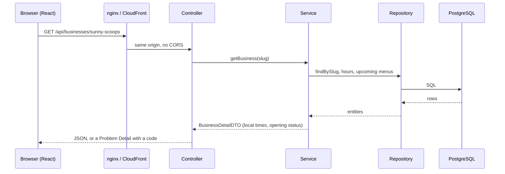
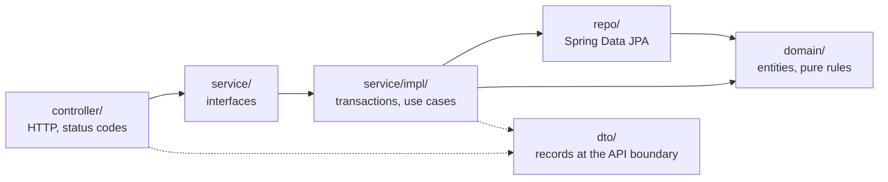
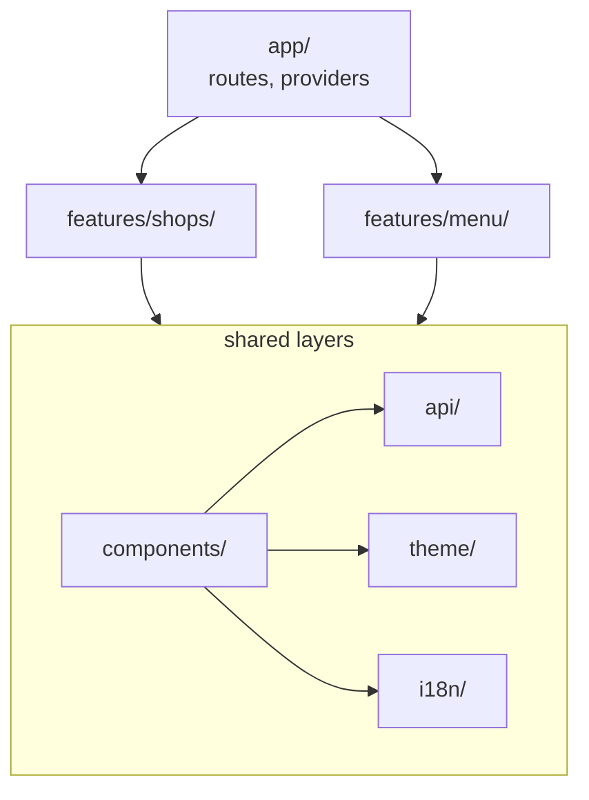

# Architecture

How the code is organized, the patterns it uses and why, and the rules that keep it that way as it grows. Infrastructure lives in the [infra plan](infra-plan.md); the domain in the [domain model](domain-model.md).

## A request, end to end



## Backend

### Layers



- **Controllers** only map HTTP to service calls. They depend on the service *interface*, so tests replace it with a mock (`@WebMvcTest`).
- **Services** hold the use cases and their transactions (`@Transactional(readOnly = true)` for reads).
- **Repositories** are Spring Data interfaces; queries that need care (fetch joins, time windows) are explicit JPQL.
- **DTOs** are Java records. Entities never reach the JSON, so the API can stay stable while the schema evolves.
- **Errors** become [RFC 9457 Problem Details](domain-model.md#errors) in one place, `GlobalExceptionHandler`, including the 401 and 403 answers of Spring Security's filters.
- **Security** lives in `security/`: the filter chain, how credentials are checked, the signed-in principal and the session cookie. It runs before any controller ([security guide](security.md)).

### Patterns

| Pattern | Where | Why |
|---|---|---|
| Layered architecture | `controller` → `service` → `repo` | One reason to change per layer; each is tested on its own |
| DTO | `dto/` records | Decouples the API from the schema; nothing lazy-loaded leaks into JSON |
| Repository | `repo/` (Spring Data JPA) | Queries behind interfaces; derived queries for the simple ones |
| Value objects | `TimeWindow`, `OpeningStatus` (records) | Immutable, validate themselves (`TimeWindow` rejects overnight windows) |
| Functional core, imperative shell | `WeeklySchedule` (pure) used by `BusinessDatabaseService` (I/O) | The tricky rules are unit-tested with plain dates, no database |
| Static factory methods | `ResourceNotFoundException.business(slug)`, `OpeningStatus.openUntil(…)` | Named constructors that keep codes and states consistent |
| Dependency injection | Constructors everywhere, including `Clock` | Swappable collaborators; a frozen clock in tests |
| Multi-tenancy by discriminator | `tenant_id` + composite foreign keys | One schema for every business; the database rejects cross-tenant rows |
| Optimistic locking | `@Version` on menu items | Concurrent reservations of the last unit cannot both succeed (slice 4) |
| Batch loading | `findByTenantIdIn`, `findByMenuIdInWithItem` | A fixed number of queries per page instead of N+1 |
| Chain of responsibility | Spring Security's filter chain | Each filter handles one concern (session, CSRF, authorization) and passes the request on or stops it |
| Strategy | `PasswordEncoder`, `SessionAuthenticationStrategy` | The hashing algorithm and what happens to the session on sign-in are swappable objects, not code paths |

**Planned:** Ports & Adapters (hexagonal) for notifications and payments, as the [product spec](product-spec.md) describes: a notification port with a WhatsApp adapter, a payment port with gateway adapters.

## Frontend

### Layers



| Folder | Holds | May import |
|---|---|---|
| `app/` | Routes, providers, the 404 page | Everything |
| `features/<name>/` | One screen and the components only it uses, with their tests | Shared layers only, never another feature or `app/` |
| `components/` | UI shared by features: header, opening status, errors, skeletons | `api/`, `theme/`, `i18n/` |
| `api/` | Typed client, `ApiError`, TanStack Query hooks | Nothing above it |
| `theme/` | Tokens, themes, fonts, item colors ([theming](theming.md)) | Nothing above it |
| `i18n/` | Catalogs and `Intl` formatting ([i18n](i18n.md)) | Nothing above it |

This is a **package-by-feature** structure: code that changes together lives together, and a feature can be read, tested or deleted as a unit. (Feature-Sliced Design is a stricter variant with more layers; it would be more ceremony than this app needs.)

### The rules enforce themselves

A convention written only in a document erodes. The dependency rules above are **ESLint errors** (`no-restricted-imports` in `frontend/eslint.config.js`), so CI fails when, for example, `features/menu` imports from `features/shops`:

```
'@/features/shops/ShopCard' import is restricted from being used by a pattern.
A feature must not import another feature or the app. Move shared code to
components/, api/, theme/ or i18n/.
```

### Patterns

| Pattern | Where | Why |
|---|---|---|
| Server state vs UI state | TanStack Query for API data; `useState` only for UI (search text, filters) | Caching, loading and error states, and refetching are solved once, not per `useEffect` |
| Adapter at the boundary | `api/client.ts` | HTTP and Problem Details become typed data and `ApiError` codes; components never see `fetch` |
| Centralized cache keys | `queryKeys` in `api/queries.ts` | Invalidation (slice 2) cannot miss a variant |
| Design tokens | `theme/themes.css` | Themes per vertical without touching components |
| URL as state | `?menu=<id>` on the shop page | A shared link opens the same service day |
| Composition | `SiteHeader` takes the page's controls as `children` | The header stays generic; each page decides what goes in it |

## Tests

| Level | Backend | Frontend |
|---|---|---|
| Unit | `WeeklyScheduleTest`: pure rules with fixed dates | Formatters, item colors, the API client with a stubbed `fetch` |
| Integration | Services, repositories and the seeder against PostgreSQL in Testcontainers, with a fixed `Clock`; the sign-in flow over HTTP with the full application (`@SpringBootTest`) | Pages through the real routes, with the API faked by **MSW** at the network level |
| Contract | `@WebMvcTest` with the real security rules: JSON shapes, date formats, Problem Details, public access | Catalog parity across locales |

Both sides freeze time in tests: the backend injects a fixed `Clock`, the frontend fakes only `Date` (`vi.useFakeTimers({ toFake: ["Date"] })`) so promises and timers keep working.
