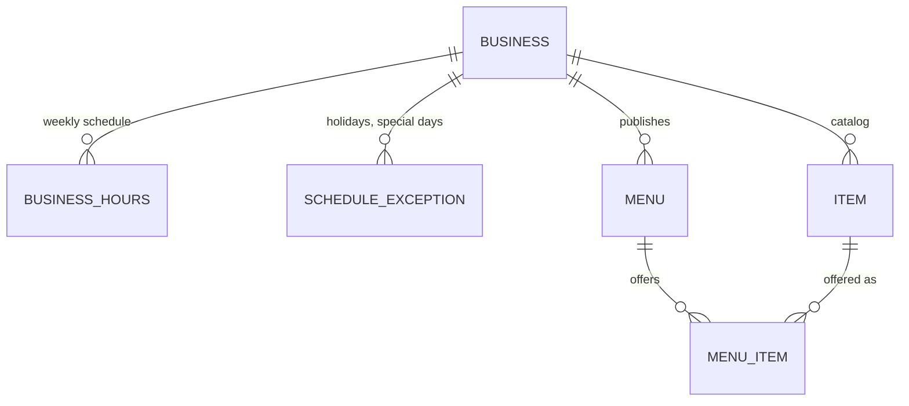

# Domain model

How the marketplace is modeled in the backend: the tables, why they look like this, how time and tenants are handled, and the public read API. The product rules live in the [product spec](product-spec.md).

## Overview



| Table | What it is | Example (ice cream shop) |
|---|---|---|
| `business` | A business on the marketplace, and the tenant that owns every other row | Sunny Scoops, `America/Mexico_City` |
| `business_hours` | One opening window of the weekly schedule; several per day allow split shifts | Saturday 11:00–21:00 |
| `schedule_exception` | Replaces the weekly schedule on one date: closed, or special hours | Closed on 25 December |
| `item` | What the business knows how to make: the catalog | Passion fruit sorbet, suggested $45 |
| `menu` | What is sold in one service: a date and a local time window | Saturday 17, 11:00–21:00 |
| `menu_item` | A catalog item offered in a menu, with that day's price and stock | Passion fruit, $45, 15 scoops |

This is the classic **catalog → offer → sale** pattern. The catalog changes rarely; menus change every day; orders (slice 4) will copy the name and price of what was sold.

Code: entities in `backend/src/main/java/dev/licaza/itacatl/domain/`, schema in `db/migration/V1__create_marketplace_schema.sql`.

## Decisions

### Prices: suggested in the catalog, charged in the menu

`item.suggested_price` is only prefilled when the item is added to a menu. `menu_item.price` is what the customer pays that day, so a promotion or a price change never rewrites published menus.

### Items are archived, never deleted

`item.archived` hides an item from the catalog while keeping past menus and orders meaningful. Deleting would either break foreign keys or lose history.

### Tenant integrity enforced by the database

Every table owned by a business has `tenant_id` (the business's ID). Children reference their parents through **composite foreign keys**:

```sql
CONSTRAINT fk_menu_item_item FOREIGN KEY (item_id, tenant_id)
    REFERENCES item (id, tenant_id)
```

A menu item can only point to a menu and an item **of the same business**: PostgreSQL rejects anything else, whatever the application code does. `TenantIntegrityIntegrationTest` proves it. The parents declare `UNIQUE (id, tenant_id)`, which a composite foreign key needs as its target.

This is the first layer of tenant isolation. Slice 3 adds Hibernate `@TenantId` and PostgreSQL Row-Level Security.

### Optimistic locking on stock

`menu_item.version` (`@Version`) is ready for the stock holds of slice 4: two customers reserving the last scoop at the same time cannot both succeed.

## Time

Time is the trickiest part of the model, so it follows three rules.

**1. Schedules are local times plus a zone.** `business.time_zone` stores a zone ID (`America/Mexico_City`), never a fixed offset. Hours and menus are `TIME` and `DATE` columns in that zone. "Opens at 12:00" stays 12:00 even if daylight saving rules change, which Mexico did in 2022.

**2. "Now" comes from an injected `Clock`.** Nothing calls `LocalDateTime.now()` directly. `ClockConfig` provides `Clock.systemUTC()`, and each business's local time is `LocalDateTime.now(clock.withZone(business.getTimeZone()))`. Tests replace the bean with `FixedClockConfig` (Saturday 17 October 2026, 11:30 in Mexico City) and check time-dependent rules deterministically.

**3. The API returns data, not sentences.** Opening status is `{ "state": "CLOSED", "opensAt": "2026-10-18T12:00:00" }`, a local date and time without an offset. The client turns it into "opens tomorrow at 12:00" in the user's language (see the [i18n guide](i18n.md)).

### Opening status

`WeeklySchedule` (in `domain/`) computes it. It is plain Java with no Spring or database access, so `WeeklyScheduleTest` covers every rule with fixed dates:

1. The windows of a date are the exception for that date if there is one, otherwise the weekly hours for its day of the week.
2. **Open** if now falls inside a window, which is `[opens, closes)`: at closing time the business is already closed.
3. Otherwise **closed**, with the next opening: later today, or the first open day within 14 days. Beyond that, closed with no date.

`BusinessDatabaseService` loads hours and exceptions for every business in two queries (`findByTenantIdIn`), not one per business, to avoid the N+1 problem on the business list.

### Limitation: no overnight windows

A window must close on the day it opens: `CHECK (closes_at > opens_at)` in the database and `TimeWindow`'s constructor. A business open 20:00–02:00 would need two windows across two days. Ice cream shops do not need it; supporting it means modeling a window as a start plus a duration.

## Public read API

All endpoints are public and read-only. Dates and times are local to the business.

| Method | Path | Returns |
|---|---|---|
| `GET` | `/api/businesses` | Every business, sorted by name, with its opening status |
| `GET` | `/api/businesses/{slug}` | Profile, weekly hours and published menus that have not ended, up to 7 days ahead |
| `GET` | `/api/menus/{id}` | A published menu with its items, prices and availability |

Businesses are addressed by **slug** (`sunny-scoops`), which gives readable, shareable URLs and does not expose internal IDs. The database checks that slugs are URL-safe.

A **draft menu answers 404**, like a missing one, so customers cannot discover unpublished menus.

### Errors

Errors follow [RFC 9457 Problem Details](https://www.rfc-editor.org/rfc/rfc9457) (`application/problem+json`) with a stable `code` the client translates:

```json
{
  "type": "about:blank",
  "title": "Resource not found",
  "status": 404,
  "detail": "No business with slug nope",
  "instance": "/api/businesses/nope",
  "code": "BUSINESS_NOT_FOUND"
}
```

`ResourceNotFoundException` carries the code, and `GlobalExceptionHandler` builds the response. `detail` is for developers; users only see the translated `code`.

## Sample data

`MarketplaceSeeder` loads businesses, catalogs and menus from a JSON file at startup:

- **Enabled** with `itacatl.seed.enabled=true` (the `local` profile does it; off by default, so production never gets sample data by accident).
- **The file is a deployment setting**, like the UI's default locale: `itacatl.seed.file` defaults to `seed/ice-cream-shops.en.json`, and a Mexican deployment sets `ITACATL_SEED_FILE=classpath:seed/ice-cream-shops.es-MX.json`. Business content is stored as written, never machine-translated.
- **Menus use a day offset**, not dates, so there are always menus for today and the next days. Each menu takes the business's first window that day, and is skipped if the business is closed.
- **Only into an empty database**, so restarting never duplicates data.
- **Typos fail**: a menu that references an unknown item key throws. `MarketplaceSeederIntegrationTest` loads every seed file, so a mistake in any language breaks the build.

To add a business to the demo, add it to **both** seed files with the same item keys.

## Tests

| Test | What it proves |
|---|---|
| `WeeklyScheduleTest` | Opening rules: windows, exclusive closing time, split shifts, exceptions, next open day |
| `BusinessServiceIntegrationTest` | Local opening status per business; which menus count as upcoming |
| `MenuServiceIntegrationTest` | Menu items with the day's price; drafts are not found |
| `TenantIntegrityIntegrationTest` | The composite foreign keys reject rows that mix businesses |
| `BusinessControllerIntegrationTest` | The HTTP contract: local ISO dates, Problem Details |
| `MarketplaceSeederIntegrationTest` | Every seed file loads, follows the schedules and is idempotent |

Integration tests run against PostgreSQL in Testcontainers, with Flyway enabled and Hibernate validating the entities against the schema.
