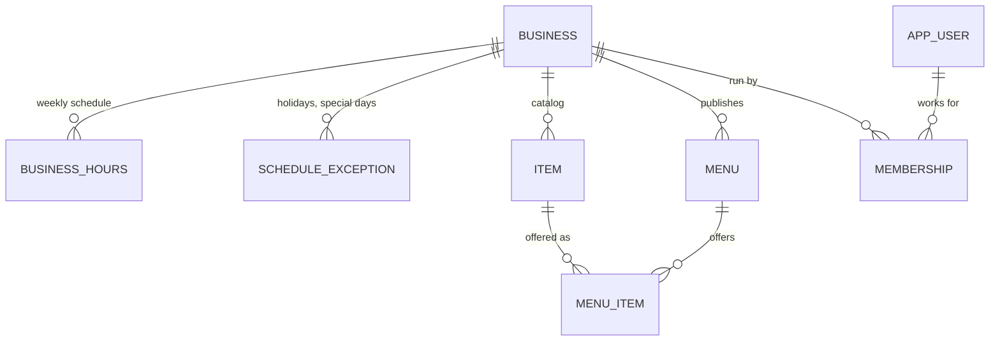
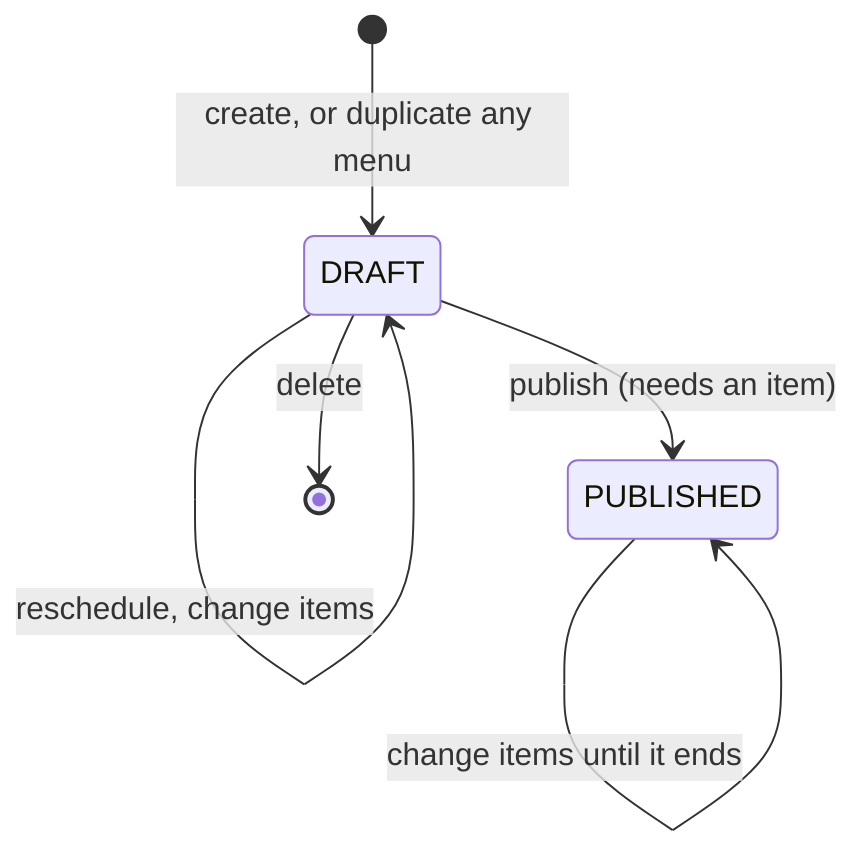

# Domain model

How the marketplace is modeled in the backend: the tables, why they look like this, how time and tenants are handled, the public read API and the management API. The product rules live in the [product spec](product-spec.md).

## Overview



| Table | What it is | Example (ice cream shop) |
|---|---|---|
| `business` | A business on the marketplace, and the tenant that owns every other row | Sunny Scoops, `America/Mexico_City` |
| `business_hours` | One opening window of the weekly schedule; several per day allow split shifts | Saturday 11:00–21:00 |
| `schedule_exception` | Replaces the weekly schedule on one date: closed, or special hours | Closed on 25 December |
| `item` | What the business knows how to make: the catalog | Passion fruit sorbet, suggested $45 |
| `menu` | What is sold in one service: a date and a local time window | Saturday 17, 11:00–21:00 |
| `menu_item` | A catalog item offered in a menu, with that day's price and stock | Passion fruit, $45, 15 scoops |
| `app_user` | Someone who signs in to manage businesses. Customers have no account | Ana, `ana@example.com` |
| `membership` | A user's role (`OWNER` or `STAFF`) in one business | Ana owns Sunny Scoops |

Accounts are a table plus memberships, not a business column on the user, so one person can run several businesses. How they sign in: [security guide](security.md).

This is the classic **catalog → offer → sale** pattern. The catalog changes rarely; menus change every day; orders (slice 4) will copy the name and price of what was sold.

Code: entities in `backend/src/main/java/dev/licaza/itacatl/domain/`, schema in `db/migration/V1__create_marketplace_schema.sql` (marketplace) and `V2__create_accounts.sql` (accounts).

## Decisions

### Prices: suggested in the catalog, charged in the menu

`item.suggested_price` is only prefilled when the item is added to a menu. `menu_item.price` is what the customer pays that day, so a promotion or a price change never rewrites published menus.

### Items are archived, never deleted

`item.archived` hides an item from the catalog while keeping past menus and orders meaningful. Deleting would either break foreign keys or lose history.

So `fk_menu_item_item` has no cascade: deleting an item that a menu uses fails. It is checked at commit (`DEFERRABLE INITIALLY DEFERRED`) so that deleting a whole business still works: PostgreSQL cascades to its items and to its menus in separate steps, and a check right after the items would still see menu items that the menus' cascade removes next.

### Tenant integrity enforced by the database

Every table owned by a business has `tenant_id` (the business's ID). Children reference their parents through **composite foreign keys**:

```sql
CONSTRAINT fk_menu_item_item FOREIGN KEY (item_id, tenant_id)
    REFERENCES item (id, tenant_id)
```

A menu item can only point to a menu and an item **of the same business**: PostgreSQL rejects anything else, whatever the application code does. `TenantIntegrityIntegrationTest` proves it. The parents declare `UNIQUE (id, tenant_id)`, which a composite foreign key needs as its target.

This is the first layer of tenant isolation. Slice 3 adds Hibernate `@TenantId` and PostgreSQL Row-Level Security.

### Optimistic locking on stock

`menu_item.version` (`@Version`) is ready for the stock holds of slice 4: two customers reserving the last scoop at the same time cannot both succeed.

## Time

Time is the trickiest part of the model, so it follows three rules.

**1. Schedules are local times plus a zone.** `business.time_zone` stores a zone ID (`America/Mexico_City`), never a fixed offset. Hours and menus are `TIME` and `DATE` columns in that zone. "Opens at 12:00" stays 12:00 even if daylight saving rules change, which Mexico did in 2022.

**2. "Now" comes from an injected `Clock`.** Nothing calls `LocalDateTime.now()` directly. `ClockConfig` provides `Clock.systemUTC()`, and each business's local time is `LocalDateTime.now(clock.withZone(business.getTimeZone()))`. Tests replace the bean with `FixedClockConfig` (Saturday 17 October 2026, 11:30 in Mexico City) and check time-dependent rules deterministically.

**3. The API returns data, not sentences.** Opening status is `{ "state": "CLOSED", "opensAt": "2026-10-18T12:00:00" }`, a local date and time without an offset. The client turns it into "opens tomorrow at 12:00" in the user's language (see the [i18n guide](i18n.md)).

### Opening status

`WeeklySchedule` (in `domain/`) computes it. It is plain Java with no Spring or database access, so `WeeklyScheduleTest` covers every rule with fixed dates:

1. The windows of a date are the exception for that date if there is one, otherwise the weekly hours for its day of the week.
2. **Open** if now falls inside a window, which is `[opens, closes)`: at closing time the business is already closed.
3. Otherwise **closed**, with the next opening: later today, or the first open day within 14 days. Beyond that, closed with no date.

`BusinessDatabaseService` loads hours and exceptions for every business in two queries (`findByTenantIdIn`), not one per business, to avoid the N+1 problem on the business list.

### Limitation: no overnight windows

A window must close on the day it opens: `CHECK (closes_at > opens_at)` in the database and `TimeWindow`'s constructor. A business open 20:00–02:00 would need two windows across two days. Ice cream shops do not need it; supporting it means modeling a window as a start plus a duration.

## Public read API

All endpoints are public and read-only. Dates and times are local to the business.

| Method | Path | Returns |
|---|---|---|
| `GET` | `/api/businesses` | Every business, sorted by name, with its time zone, opening status and `featuredItems` |
| `GET` | `/api/businesses/{slug}` | Profile, weekly hours and published menus that have not ended, up to 7 days ahead |
| `GET` | `/api/menus/{id}` | A published menu with its items, prices and availability |

Businesses are addressed by **slug** (`sunny-scoops`), which gives readable, shareable URLs and does not expose internal IDs. The database checks that slugs are URL-safe.

A **draft menu answers 404**, like a missing one, so customers cannot discover unpublished menus.

**`featuredItems`** are the item names of each business's current or next menu within a week, so the home page can show what each business offers. They are loaded for every business in **two queries** (candidate menus, then their items), not one request or query per business: the classic N+1 problem. The "not ended yet" filter runs in Java, because each business has its own time zone and a single SQL `now` cannot fit them all.

## Management API

What the owner panel (slice 2c) uses. Every endpoint lives under `/api/manage/businesses/{slug}` and needs a signed-in member of that business: owners change things, staff only read. How that is checked: [security guide](security.md#per-business-permissions-method-security).

| Method | Path | Does |
|---|---|---|
| `GET` | `/items` | The catalog, archived items included, by name |
| `POST` | `/items` | Creates an item (201) |
| `PUT` | `/items/{itemId}` | Replaces an item's fields. Menus keep their own price |
| `POST` | `/items/{itemId}/archive`, `/unarchive` | Hides an item from the catalog, or brings it back |
| `GET` | `/menus?from=` | Menus from a date on, drafts included; from today by default |
| `GET` | `/menus/{menuId}` | One menu with its items |
| `POST` | `/menus` | Creates an empty draft for a date and window (201) |
| `PUT` | `/menus/{menuId}` | Moves a draft to another date or window |
| `POST` | `/menus/{menuId}/duplicate` | A new draft with the menu's items, for another service (201) |
| `POST` | `/menus/{menuId}/publish` | Shows the menu to customers |
| `DELETE` | `/menus/{menuId}` | Deletes a draft (204) |
| `POST` | `/menus/{menuId}/items` | Offers a catalog item, at its suggested price unless one is given |
| `PUT` | `/menus/{menuId}/items/{itemId}` | That day's price and quantity |
| `DELETE` | `/menus/{menuId}/items/{itemId}` | Stops offering the item |

How it is shaped:

- **Scoped to the business in the URL.** Items and menus are looked up by ID *and* tenant, so an ID of another business answers 404, as if it did not exist, instead of revealing it.
- **Menu items are addressed by their catalog item** (`/items/{itemId}`), since a menu offers each item once (`uq_menu_item`).
- **Every menu change answers with the whole menu** (`ManagedMenuDTO`), so the panel replaces its copy instead of patching it.
- **Actions are endpoints of their own** (`/archive`, `/publish`) rather than a `PATCH` of a flag, because they have their own rules and, for publishing, no way back.

### A menu's lifecycle



| Rule | Why |
|---|---|
| No menu is planned for, or changed after, the end of its window (`MENU_ENDED`), in the business's time zone. A window that closed earlier today counts | An ended menu is history, and orders (slice 4) will point at it. A new menu for a window already over would never reach a customer |
| Only drafts are rescheduled or deleted (`MENU_NOT_DRAFT`) | Customers may already plan around a published menu. A draft nobody saw can be deleted even after its date |
| A published menu's items can still change | Stock runs out and prices get fixed during the day. Slice 4 will limit this once orders exist |
| Publishing needs at least one item that is not archived (`MENU_EMPTY`); publishing again changes nothing, even after the menu ended | An empty menu would only confuse customers; a retried request is harmless |
| Duplicating copies the source's price and quantity, and leaves archived items out | The price last charged is a better start than the catalog's suggestion; an archived item could not be added by hand either. The source may be in the past: repeating yesterday's menu is the common case |
| A catalog item is offered once per menu (`ITEM_ALREADY_IN_MENU`), never while archived (`ITEM_ARCHIVED`) | The unique constraint decides, so two concurrent requests cannot both add it. Only a violation of `uq_menu_item` becomes this code; any other is a bug and stays a 500 |

### Concurrent changes to one menu

The rules above are checks followed by a write, so two requests at once could both pass them: a `publish` sees one item while a `removeItem` deletes it, and an empty menu goes public; a `reschedule` that loaded a draft writes `DRAFT` back over a concurrent `publish`.

The menu is the **root of its items** (an aggregate), so every change to a menu or its items first locks the menu's row: `findByIdAndTenantIdForUpdate`, a `@Lock(PESSIMISTIC_WRITE)` query that Hibernate turns into `SELECT … FOR UPDATE`. A second request on the same menu waits until the first commits and then sees its result. Reads take no lock.

| Option | Why not here |
|---|---|
| `@Version` on `menu` (optimistic) | Detects a conflict instead of preventing it, so the client needs a retry or a 409 flow. And `removeItem` does not change the menu's row, so it would not catch the empty-menu case without forcing a version bump |
| `SERIALIZABLE` transactions | Works, but every service call would need retries for serialization failures |

A row lock is cheap here: transactions are short, and one owner editing one menu rarely competes with anyone. Reservations (slice 4) are the opposite, many customers on the same items, which is why `menu_item` has `@Version` for optimistic locking on stock.

## Errors

Errors follow [RFC 9457 Problem Details](https://www.rfc-editor.org/rfc/rfc9457) (`application/problem+json`) with a stable `code` the client translates:

```json
{
  "type": "about:blank",
  "title": "Resource not found",
  "status": 404,
  "detail": "No business with slug nope",
  "instance": "/api/businesses/nope",
  "code": "BUSINESS_NOT_FOUND"
}
```

`ResourceNotFoundException` and `BusinessRuleException` carry the code through static factories (`ResourceNotFoundException.menu(id)`), and `GlobalExceptionHandler` builds the response. `detail` is for developers; users only see the translated `code`.

| Status | Codes | When |
|---|---|---|
| 400 | `VALIDATION_FAILED` | A request body breaks its Bean Validation constraints |
| 400 | `MALFORMED_REQUEST` | The body is not JSON, or a value has the wrong type (text where a price goes) |
| 404 | `BUSINESS_NOT_FOUND`, `ITEM_NOT_FOUND`, `MENU_NOT_FOUND`, `MENU_ITEM_NOT_FOUND` | Missing, or belonging to another business |
| 422 | `INVALID_TIME_WINDOW`, `MENU_ENDED`, `MENU_NOT_DRAFT`, `MENU_EMPTY`, `ITEM_ARCHIVED`, `ITEM_ALREADY_IN_MENU` | A well-formed request that a business rule rejects ([lifecycle](#a-menus-lifecycle)) |

Authentication and permission errors (401, 403) are in the [security guide](security.md#a-rejected-request).

### Validation: two kinds of "no"

- **Format, per field: Bean Validation, 400.** Request DTOs are records with constraints (`@NotBlank`, `@Size(max = 120)`, `@PositiveOrZero`, `@Digits(integer = 8, fraction = 2)`), whose limits match the columns, and controllers mark the body `@Valid`. Every invalid field is listed, with the constraint's name as its code, so a form shows a translated message next to each input:

  ```json
  {
    "status": 400,
    "code": "VALIDATION_FAILED",
    "errors": [
      { "field": "name", "code": "NotBlank" },
      { "field": "suggestedPrice", "code": "PositiveOrZero" }
    ]
  }
  ```

- **Rules, across fields or against the database: the service, 422.** A window that ends before it starts, a date that has passed, publishing an empty menu. These need other fields, the clock or stored data, so they live in the service and throw `BusinessRuleException`. The database's `CHECK` constraints stay as a last line of defense; checking first in Java turns what would be a 500 into a code the client can translate.

To add a rule: a factory method in `BusinessRuleException` with a new code, a test in the service's integration test, the code in this table, and its translation in the frontend's `apiErrors` catalogs when a screen can show it.

## Sample data

`MarketplaceSeeder` loads businesses, catalogs and menus from a JSON file at startup:

- **Enabled** with `itacatl.seed.enabled=true` (the `local` profile does it; off by default, so production never gets sample data by accident).
- **The file is a deployment setting**, like the UI's default locale: `itacatl.seed.file` defaults to `seed/ice-cream-shops.en.json`, and a Mexican deployment sets `ITACATL_SEED_FILE=classpath:seed/ice-cream-shops.es-MX.json`. Business content is stored as written, never machine-translated.
- **Menus use a day offset**, not dates, so there are always menus for today and the next days. Each menu takes the business's first window that day, and is skipped if the business is closed.
- **Demo accounts:** the file lists `users` (email and name) and each business its `members` with a role. Ana owns two shops, which shows one account running several businesses; Luis owns one and is staff in another. The file holds no passwords: every account gets `itacatl.seed.user-password`, which only the `local` profile sets (`itacatl-demo`), and seeding fails fast without it.
- **Only into an empty database**, so restarting never duplicates data.
- **Typos fail**: a menu that references an unknown item key throws. `MarketplaceSeederIntegrationTest` loads every seed file, so a mistake in any language breaks the build.

To add a business to the demo, add it to **both** seed files with the same item keys.

## Tests

| Test | What it proves |
|---|---|
| `WeeklyScheduleTest` | Opening rules: windows, exclusive closing time, split shifts, exceptions, next open day |
| `BusinessServiceIntegrationTest` | Local opening status per business; which menus count as upcoming |
| `MenuServiceIntegrationTest` | Menu items with the day's price; drafts are not found |
| `CatalogServiceIntegrationTest` | Each business sees only its own items, archived ones included; text is trimmed |
| `MenuManagementServiceIntegrationTest` | The menu rules above: ended menus, drafts only, empty menus, duplicates, suggested prices, other businesses' IDs |
| `GlobalExceptionHandlerTest` | Field errors with their constraint as code; unreadable bodies |
| `TenantIntegrityIntegrationTest` | The composite foreign keys reject rows that mix businesses |
| `AccountRepositoryIntegrationTest` | A user's businesses in one query, lowercase emails, one membership per user and business |
| `BusinessControllerIntegrationTest` | The HTTP contract: local ISO dates, Problem Details |
| `MarketplaceSeederIntegrationTest` | Every seed file loads, follows the schedules, creates accounts that can sign in and is idempotent |

Integration tests run against PostgreSQL in Testcontainers, with Flyway enabled and Hibernate validating the entities against the schema.

## Gotchas

- **Run `mvn clean` after deleting or renaming a migration.** Maven copies resources into `target/classes` but never removes old ones, so a deleted `V1__…sql` stays there and Flyway fails with "Found more than one migration with version 1". CI always builds from scratch, so it only bites locally.
- **Tests that roll back never check a deferred constraint.** `fk_menu_item_item` is checked at commit, and `@DataJpaTest` rolls every test back, so a row that breaks it is silently accepted. `TenantIntegrityIntegrationTest` runs `SET CONSTRAINTS ALL IMMEDIATE`, which makes PostgreSQL check the pending rows at that point, as the commit would.
- **Jackson 3 is stricter than Jackson 2.** `FAIL_ON_NULL_FOR_PRIMITIVES` is on by default: a JSON field missing for a primitive (`boolean`, `int`) fails instead of becoming `false` or `0`. Optional fields use wrapper types (`Boolean alcoholic` in `SeedFile`), and required numbers stay primitive so a missing value is caught.
