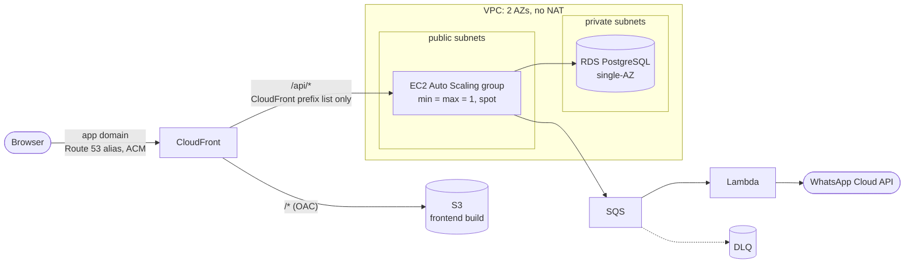

# AWS Infrastructure Plan

## Goal

Make the application deployable to AWS with Terraform in a single environment, `prod`, built to be as cheap as possible. The target customers are small businesses, so the platform has to run at a cost that a marketplace of modest *fondas* can carry.

The infrastructure is **deploy-ready but kept off**: it is checked on every PR without access to AWS (format, lint, security scan, tests against a mocked provider, cost estimate), and applied by the maintainer from their machine only to capture evidence, then destroyed. CI never gets AWS credentials. The design is recorded in [ADR 0002](adr/0002-low-cost-production-architecture.md); how the code is written, checked and deployed, in the [Terraform guide](terraform.md).

The same application image runs locally and in AWS; only configuration changes. Product scope lives in [product-spec.md](product-spec.md).

Assumptions: the account has no credits or 12-month free tier (only *always-free*), the region is `us-east-1`, and the `licaza.dev` hosted zone already exists in Route 53.

## Architecture



- **Backend:** an Auto Scaling group of one instance using a mixed instances policy with spot capacity (`price-capacity-optimized` across several Graviton types) and capacity rebalancing. The ASG replaces the instance when it is reclaimed or fails. A variable switches to on-demand. The instance runs the backend image with Docker; the database never runs on it.
- **Database:** RDS PostgreSQL (PostGIS as an extension), smallest Graviton class, single-AZ, automated backups. The master password is managed by RDS in Secrets Manager. The master user owns the tables and runs Flyway; the backend connects as `itacatl_app`, a role subject to Row-Level Security, which must exist before the first migration ([tenant isolation](tenant-isolation.md#two-database-roles)). Its password is an SSM SecureString, which adds no cost.
- **Frontend:** static build in S3, served by CloudFront. Same origin for the app and `/api`, so no CORS in AWS.
- **Notifications:** the backend publishes to SQS; a Lambda outside the VPC sends the WhatsApp messages. Reservations stay synchronous, because they must check stock before confirming.
- **Images:** ECR with a lifecycle policy that keeps the last few tags.
- **Deploys:** the image tag lives in SSM Parameter Store; a deploy updates it and starts an ASG instance refresh. With a single instance this means a few minutes of downtime, accepted and documented.
- **Configuration:** SSM Parameter Store (SecureString for secrets other than the database password).
- **Access:** SSM Session Manager, no SSH.
- **Observability:** CloudWatch Logs with short retention, alarms (instance health, RDS storage and CPU, DLQ depth, CloudFront 5xx) and one dashboard.

## Cost rules

| Rule | Why |
|---|---|
| **At most $25/month when running** | The ceiling for the whole marketplace: what a group of small businesses can carry together. Pay per use only, with no reservations or savings plans, so destroying the environment brings the bill to cents. Any change that would push the estimate past it is redesigned, not accepted |
| No NAT gateway | ~$33/month on its own. The EC2 instance sits in a public subnet with a security group that only allows the CloudFront prefix list; RDS needs no internet access. For the same reason the instance does not move to a private subnet behind CloudFront VPC origins: it would then need a NAT gateway or interface endpoints to reach ECR and SSM |
| No load balancer | ~$17/month. CloudFront terminates TLS and reaches the instance directly |
| No Multi-AZ by default | Doubles the database cost. The ASG and RDS backups cover the failures a small marketplace can tolerate |
| No interface VPC endpoints | ~$7/month each |
| Spot for compute | About a third of the on-demand price |
| Short log retention | 14 days |
| AWS Budgets with alerts | Catches anything left running after an ephemeral apply. Configured on the account, outside this repository |

### Estimated monthly cost if left running

Approximate on-demand prices in `us-east-1`, before Infracost validates them:

| Item | USD/month |
|---|---|
| EC2 `t4g.small` spot + EBS | ~6 |
| Public IPv4 address | ~4 |
| RDS `db.t4g.micro` single-AZ + 20 GB | ~14 |
| Secrets Manager (database password) | ~0.40 |
| S3, CloudFront, ECR, SQS, Lambda | ~1 |
| CloudWatch | ~1–3 |
| **Total** | **~25** |

WhatsApp messages are billed by Meta per conversation and are capped by the limits in the product spec.

## Terraform layout

```
infra/
├── bootstrap/          # state bucket
├── modules/
│   ├── network/        # VPC, public and private subnets, no NAT
│   ├── frontend/       # S3 + CloudFront + OAC + ACM
│   ├── backend/        # ECR, launch template, ASG, IAM, security group
│   ├── database/       # RDS
│   ├── notifications/  # SQS, DLQ, Lambda
│   └── observability/  # alarms, dashboard
├── envs/
│   └── prod/
└── lambdas/            # notification sender
```

- State in S3 with `use_lockfile`.
- `default_tags` on the provider: `Project`, `Env`, `ManagedBy`.
- Every stack and module has `terraform test` files that run against a mocked AWS provider.

## Work phases

The product rework ([roadmap in the product spec](product-spec.md#rework-roadmap)) runs after Phase 0 and before Phase 4, so the deployment evidence comes from the real domain.

### Phase 0: Prepare the app
- [x] Migrate from MariaDB to PostgreSQL (driver, Flyway migrations, compose)
- [x] App CI on every PR and a ruleset on `main` (see [CI and repository safeguards](ci.md))
- [x] Add `.env.example` and remove `.env` from the repo
- [x] Replace `System.out.println` with SLF4J and align on Java 21
- [x] Non-root user in the Dockerfiles; memory limits (JVM and PostgreSQL)
- [x] Frontend: relative API path `/api`
- [x] Rename the project to `itacatl` in a rename-only PR (Java package, Maven, compose, docs), then rename the GitHub repository.

**Done when:** `docker compose up` works as before and the project is named `itacatl`.

Phases 1 to 3 need no AWS account: each tool joins the Nix shell in the phase that first uses it.

### Phase 1: Bootstrap
- [x] Add to `flake.nix`: `terraform` (HashiCorp's binary) and `tflint`
- [x] `bootstrap/`: the state bucket, with tests against a mocked provider
- [x] [Terraform guide](terraform.md), with the first-deploy runbook

**Done when:** the bootstrap passes `fmt`, `validate`, `tflint` and its tests without AWS credentials.

### Phase 2: Modules
One PR per module, in this order; each joins `envs/prod` in the same PR, so the stack can always be planned as a whole.

- [x] Add `terraform-docs` to `flake.nix`, with a plugin cache shared by every directory
- [x] `network` module, and `envs/prod` wiring it
- [ ] `database` module
- [ ] `backend` module; add `trivy` to `flake.nix`, now that there are resources worth scanning
- [ ] `frontend` module
- [ ] `observability` module
- [ ] The runbook's remaining steps: applying `envs/prod` and pushing the backend image to ECR
- [ ] `notifications` module, postponed until slices 5 and 6 need it

**Done when:** `envs/prod` passes the same checks, `trivy` finds nothing unaccepted, and an Infracost estimate stays within the table above.

### Phase 3: CI
- [x] `fmt`, `tflint`, `validate` and `terraform test` on PRs, with no AWS credentials, through the flake's `infra` shell (brought forward to Phase 1)
- [ ] `trivy` on PRs
- [ ] Add `infracost` to `flake.nix` (free API key, kept out of the repository) and run it on PRs

### Phase 4: Ephemeral deploy and evidence
- [ ] Add `awscli2` to `flake.nix`; apply the bootstrap and migrate its state ([runbook](terraform.md#first-deploy))
- [ ] Apply, seed sample data and run a smoke test
- [ ] Load test with k6 and capture the dashboard
- [ ] Simulate a spot interruption and measure recovery
- [ ] Restore the database from a snapshot
- [ ] Destroy and confirm that nothing is left running

### Phase 5: Documentation
- [ ] README with diagram, cost table and evidence

## Open decisions

- Production domain.
- CloudFront flat-rate free plan (includes WAF) if compatible with an EC2 origin; otherwise rate limiting in Spring with Bucket4j.
- How `itacatl_app` is created in RDS. The Terraform PostgreSQL provider needs network access to the database, which is not public; the alternatives are a one-time step through SSM Session Manager on the instance, or the backend creating it at startup with the master credentials before Flyway runs.
