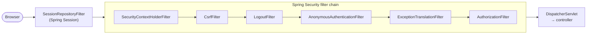
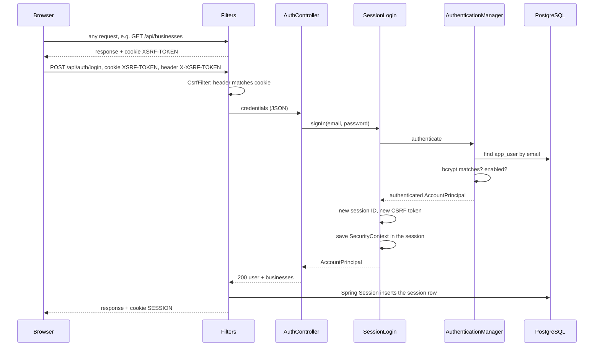

# Security

How business owners and staff sign in, how their sessions are kept, and how the API protects them. This is the first use of **Spring Security** in the project, so the guide starts with the framework's concepts and then shows how each one is wired in here, from the filter chain to the per-business permissions of the management API. Account tables are in the [domain model](domain-model.md); the decision to use sessions instead of JWT is [ADR 0004](adr/0004-server-side-sessions-instead-of-jwt.md).

Customers have no account: they browse the public marketplace and, from slice 5, verify a phone number when they reserve ([product spec](product-spec.md#customer-identity)).

## What Spring Security does

Security answers two questions on every request:

- **Authentication:** who is this? (a signed-in owner, or nobody)
- **Authorization:** may they do this? (read the marketplace, see their account, edit a menu)

Spring Security answers them with a **chain of servlet filters** that runs before Spring MVC. A request reaches a controller only if every filter lets it through:



Writing this by hand (a filter that reads a cookie and checks a password) looks simple, but the hard parts are the ones that are easy to miss: storing passwords safely, session fixation, CSRF, timing attacks that reveal which emails exist, security headers. Spring Security solves them in audited, widely used code, and the project only configures it.

## Core concepts

| Concept | What it is | In this repo |
|---|---|---|
| `SecurityFilterChain` | The ordered list of security filters, configured with the `HttpSecurity` builder | `SecurityConfig.securityFilterChain` |
| `Authentication` | Who is making the request: a principal, credentials and authorities. It goes into an `AuthenticationManager` unauthenticated (email and password) and comes out authenticated (the account) | `UsernamePasswordAuthenticationToken` in `SessionLogin` |
| `SecurityContext` | Holds the current request's `Authentication`. `SecurityContextHolder` keeps it in a thread-local while the request runs | Read by `@AuthenticationPrincipal` in controllers |
| `SecurityContextRepository` | Where the context lives between requests. Loaded at the start of each request, saved after sign-in | The HTTP session (`SecurityConfig.securityContextRepository`) |
| `AuthenticationManager` | Checks credentials. `ProviderManager` asks its `AuthenticationProvider`s in turn | `AuthenticationConfig.authenticationManager` |
| `DaoAuthenticationProvider` | The provider for username and password: loads the account with a `UserDetailsService`, compares the password with a `PasswordEncoder` | Configured in `AuthenticationConfig` |
| `UserDetailsService` / `UserDetails` | How to find an account by username, and the account as Spring Security sees it | `AccountUserDetailsService` / `AccountPrincipal` |
| `PasswordEncoder` | Hashes and verifies passwords | `DelegatingPasswordEncoder` with bcrypt |
| `AuthenticationEntryPoint` / `AccessDeniedHandler` | What to answer when a request needs a sign-in (401) or is forbidden (403) | Both hand the error to `GlobalExceptionHandler` |
| `SessionAuthenticationStrategy` | What to do to the session when someone signs in | New session ID and new CSRF token |
| Method security (`@PreAuthorize`) | An authorization check on a method instead of a URL, run by a proxy around the bean before the method | The service interfaces of the management API, with `BusinessAccess` |

### The filters that matter here

Spring Security prints the chain at startup with `logging.level.org.springframework.security=DEBUG`. These are the ones that do work in this app, in order:

| Filter | What it does |
|---|---|
| `SecurityContextHolderFilter` | Loads the `SecurityContext` from the session at the start of the request, clears it at the end |
| `HeaderWriterFilter` | Adds security headers: `X-Content-Type-Options: nosniff`, `X-Frame-Options: DENY`, and `Cache-Control` headers that keep responses out of caches |
| `CsrfFilter` | Issues the CSRF token cookie, and rejects `POST`, `PUT`, `PATCH` and `DELETE` requests without a matching token |
| `LogoutFilter` | Handles `POST /api/auth/logout`: invalidates the session and clears the CSRF token |
| `AnonymousAuthenticationFilter` | Gives requests without a session an "anonymous" `Authentication`, so the next filters always have one to check |
| `ExceptionTranslationFilter` | Turns security exceptions thrown later into a 401 (via the entry point) or a 403 (via the access denied handler) |
| `AuthorizationFilter` | Applies the rules in `authorizeHttpRequests` |

## How it is wired in

| File | Role |
|---|---|
| `security/SecurityConfig.java` | The filter chain: access rules, CSRF, logout, error handling. Also the beans the login endpoint shares with the filters |
| `security/AuthenticationConfig.java` | `PasswordEncoder` and `AuthenticationManager` |
| `security/AccountUserDetailsService.java` | Finds an `AppUser` by email |
| `security/AccountPrincipal.java` | The signed-in user kept in the session |
| `security/SessionConfig.java` | Flags of the `SESSION` cookie |
| `security/SessionLogin.java` | Signs a user in: checks the credentials, protects the session and stores the user in it |
| `security/BusinessAccess.java` | Per-business permissions: may this user manage, or view, this business? |
| `service/CatalogService.java`, `service/MenuManagementService.java` | `@PreAuthorize` on every method of the management API |
| `controller/AuthController.java` | `POST /api/auth/login`, `GET /api/auth/me`. Only HTTP: sign-in goes to `SessionLogin`, the user's data to `AccountService` |
| `exception/GlobalExceptionHandler.java` | Security errors as Problem Details with stable codes |
| `db/migration/V2__create_accounts.sql` | `app_user` and `membership` |
| `db/migration/V3__create_session_tables.sql` | Spring Session's tables |
| `application.properties`, `application-aws.properties` | Session timeout; `Secure` cookie in AWS |

Dependencies: `spring-boot-starter-security`, `spring-boot-starter-session-jdbc` and, for tests, `spring-boot-starter-security-test`.

### Access rules

```java
.requestMatchers(HttpMethod.GET, "/api/businesses/**", "/api/menus/**").permitAll()
.requestMatchers(HttpMethod.POST, "/api/auth/login").permitAll()
.requestMatchers("/actuator/health/**", "/error").permitAll()
.requestMatchers("/api/**").authenticated()
.anyRequest().denyAll()
```

- **The first matching rule wins**, so specific rules go before general ones.
- **Closed by default:** every `/api` endpoint needs a signed-in user unless it is listed as public, and any other path is denied. A new endpoint is never public by accident.
- `/error` is public because Spring Boot forwards errors there; denying it would hide the real error behind a 401.
- `/actuator/health` is public for the container health check.

### Accounts, memberships and permissions

An account (`app_user`) has no global role. What it can do depends on the business, so permissions come from its **memberships** (`OWNER` or `STAFF` per business), and `AccountPrincipal.getAuthorities()` is empty on purpose.

Memberships are read from the database on each request that needs them (`GET /api/auth/me` and every management call), not stored in the session. A membership that is removed takes effect on the next request, without waiting for the user to sign in again.

### Per-business permissions: method security

The URL rules only know whether someone is signed in. Whether Ana may edit Sunny Scoops' menu depends on her membership in *that* business, so it is checked one level down, on the services, with **method security** (`@EnableMethodSecurity` on `SecurityConfig`):

```java
public interface MenuManagementService {

  @PreAuthorize("@businessAccess.canView(authentication, #slug)")
  ManagedMenuDTO getMenu(String slug, Long menuId);

  @PreAuthorize("@businessAccess.canManage(authentication, #slug)")
  ManagedMenuDTO publish(String slug, Long menuId);
}
```

- **How it runs.** Spring wraps the service bean in a proxy. Before each call, the proxy evaluates the SpEL expression: `@businessAccess` is the `BusinessAccess` bean, `authentication` the current user and `#slug` the method's argument (readable by name because Spring Boot's Maven parent compiles with `-parameters`). `false` throws `AccessDeniedException`, which becomes `403 ACCESS_DENIED`.
- **What it checks.** `canManage` is owners only; `canView` is owners and staff. Both ask the database whether the user has one of those roles in the business with that slug, in one `exists` query. Anonymous requests never get this far (the URL rules answer 401), and `BusinessAccess` still returns `false` for them.
- **On the interface, not the controller.** The permission is part of the service's contract: any future caller (a scheduled job, a second controller) gets the same check, and the rule is next to the method's documentation.
- **Then the data is scoped too.** Permission on the slug is not enough on its own: a menu ID could belong to another business. The services look every ID up together with the business (`findByIdAndTenantId`), so a foreign ID answers 404, not someone else's data. The two answers differ on purpose: slugs are public (every business is on the marketplace), so a 403 for one reveals nothing, while a 403 for an internal ID would confirm that it exists somewhere. Slice 3 adds Row-Level Security as a third layer in the database.

| Layer | Question | Answer when it fails |
|---|---|---|
| URL rules (`authorizeHttpRequests`) | Is someone signed in? | 401 `AUTHENTICATION_REQUIRED` |
| Method security (`@PreAuthorize`) | Is this user an owner, or a member, of this business? | 403 `ACCESS_DENIED` |
| Tenant-scoped queries | Does this ID belong to this business? | 404 `…_NOT_FOUND` |

## A request, step by step

### Signing in



1. **The app gets a CSRF token.** Every response carries the `XSRF-TOKEN` cookie, so the app has one as soon as it has loaded anything, a marketplace page or `GET /api/auth/me`.
2. **The login request passes the `CsrfFilter`,** because its `X-XSRF-TOKEN` header matches the cookie.
3. **`AuthController` hands the credentials to `SessionLogin`,** which asks the `AuthenticationManager` to check them. `DaoAuthenticationProvider` loads the account through `AccountUserDetailsService`, checks that it is enabled, and compares the password with bcrypt.
4. **On success, `SessionLogin` does what a filter-based login would do:**
   - `SessionAuthenticationStrategy` changes the session ID and replaces the CSRF token. A new ID defeats *session fixation*, where an attacker plants a session ID in the victim's browser before sign-in and reuses it afterwards.
   - The `SecurityContext` is saved in the session through the `SecurityContextRepository`.
5. **The controller answers with the user and their businesses,** and on the way out Spring Session's filter stores the session in PostgreSQL and sends the `SESSION` cookie.

On failure, `AuthenticationManager` throws an `AuthenticationException`, which becomes `401 INVALID_CREDENTIALS`.

### An authenticated request

1. `SessionRepositoryFilter` reads the `SESSION` cookie and loads that session from PostgreSQL.
2. `SecurityContextHolderFilter` takes the `SecurityContext` out of the session.
3. `AuthorizationFilter` checks the rule for the path: `/api/**` needs an authenticated user, and there is one.
4. The controller receives the account with `@AuthenticationPrincipal AccountPrincipal principal`.

### A rejected request

Security errors happen inside filters, before Spring MVC, so `@RestControllerAdvice` would normally never see them. `SecurityConfig` gives the entry point and the access denied handler to Spring MVC's `HandlerExceptionResolver`, and `GlobalExceptionHandler` renders them like any other error:

| Code | Status | When |
|---|---|---|
| `AUTHENTICATION_REQUIRED` | 401 | An endpoint that needs a signed-in user, called without a session |
| `INVALID_CREDENTIALS` | 401 | A failed sign-in: unknown email, wrong password or disabled account |
| `CSRF_TOKEN_INVALID` | 403 | A state-changing request without a valid CSRF token |
| `ACCESS_DENIED` | 403 | A signed-in user without that permission in the business: staff changing a menu, or anyone outside it |
| `ACCOUNT_NOT_FOUND` | 404 | A session whose account was deleted |

The client translates the code, as with every other API error ([i18n guide](i18n.md)). The owner panel's sign-in form and its session handling are in the [owner panel guide](owner-panel.md#the-session).

## Passwords

- **bcrypt.** A slow, salted hash: each hash has its own random salt, so equal passwords get different hashes, and the cost factor (10 by default) makes guessing expensive.
- **`DelegatingPasswordEncoder`.** Hashes are stored with their algorithm as a prefix (`{bcrypt}$2a$10$…`). The default algorithm can change later while existing hashes keep working.
- **No user enumeration.** An unknown email and a wrong password return the same `INVALID_CREDENTIALS`, and `DaoAuthenticationProvider` runs bcrypt even when the email does not exist, so response times do not reveal it either. A disabled account gets the same answer.
- **Credentials do not linger.** `ProviderManager` erases the password hash from `AccountPrincipal` before it is stored in the session. `LoginRequestDTO` overrides the `toString` every record has, so the password never reaches a log.
- **Emails are case-insensitive.** `AppUser.normalizeEmail` trims and lowercases them on sign-in and when accounts are created, and a database `CHECK` rejects anything else.
- **Failed sign-ins are logged without the email** (`❌ Sign-in failed`): it is personal data, and users sometimes type their password into it.

## Sessions with Spring Session JDBC

By default the servlet container keeps sessions in the memory of the server. **Spring Session** replaces that storage: `SessionRepositoryFilter` wraps every request, so code that uses `HttpSession` (including Spring Security) works unchanged, but the session is read from and written to PostgreSQL.

Why it matters here:

- **Sessions survive the instance.** In AWS, the backend is a single spot instance that can be reclaimed or replaced on every deploy ([ADR 0002](adr/0002-low-cost-production-architecture.md)). In-memory sessions would sign every owner out each time.
- **No extra service.** Redis is the usual session store, but it would be another paid service. PostgreSQL is already there, and the load of a small marketplace's owners is tiny.
- **Ready to scale out.** Any instance can serve any session, so no sticky sessions are needed.
- **Revocable.** A session is a row: deleting it signs that user out on the next request.

How it works:

| Aspect | Detail |
|---|---|
| Tables | `spring_session` (one row per session: ID, expiry, principal name) and `spring_session_attributes` (serialized attributes such as the `SecurityContext`). Created by Flyway in `V3`; Spring Session's own initializer only runs on embedded databases |
| Timeout | `spring.session.timeout=12h` of inactivity: a working day on the owner's phone without signing in again |
| Cleanup | A scheduled job deletes expired sessions every minute (`spring.session.jdbc.cleanup-cron`) |
| Writes | Each authenticated request updates the session's last access time: one small `UPDATE`, accepted at this scale |
| Serialization | Attributes use Java serialization. That is why `AccountPrincipal` is small and has a `serialVersionUID` |

### The session cookie

`SessionConfig` declares the `SESSION` cookie's flags in code, because they are security settings and the servlet container's defaults differ between Tomcat and tests:

| Flag | Value | Why |
|---|---|---|
| `HttpOnly` | Always | JavaScript cannot read it, so a cross-site scripting bug cannot steal the session |
| `SameSite` | `Lax` | Browsers do not send it on requests started by other sites, except top-level navigation |
| `Secure` | `aws` profile | Only over HTTPS. Set explicitly because CloudFront reaches the instance over HTTP, so the app cannot tell from the request |

## CSRF in a single-page app

**The attack.** The browser attaches cookies to every request to a site, including requests started by another site. Without protection, a malicious page could submit a form to `/api/auth/logout`, or later to an endpoint that edits a menu, and the owner's session cookie would go with it.

**The defense: a token the other site cannot read.** This is the *cookie-to-header* (double-submit) pattern:

1. The server sends a random token in the `XSRF-TOKEN` cookie, readable by JavaScript.
2. The app copies it into the `X-XSRF-TOKEN` header of every `POST`, `PUT`, `PATCH` and `DELETE`.
3. `CsrfFilter` checks that the header matches the cookie.

A page on another origin cannot read the cookie (same-origin policy), so it cannot set the header. `GET` requests are not checked, which is why a `GET` must never change anything.

**What `csrf.spa()` sets up** (new in Spring Security 7):

- A `CookieCsrfTokenRepository` with `HttpOnly` off, so the app can read the token.
- A request handler that loads the token on every request, so the cookie is always present, and accepts the raw token from the header.

`SecurityConfig` also declares the repository as a bean, because the login endpoint uses it to **replace the token after sign-in**. Logout clears it.

**Why tokens if the session cookie is `SameSite=Lax`?** Defense in depth. "Same site" is not "same origin": a page on any subdomain of the same registrable domain counts as same-site and would get the cookie. Older browsers ignore `SameSite`. The token does not depend on either.

**Is a cookie that JavaScript can read a risk?** Not for this purpose. The token only proves that a request comes from the app's own pages. A script injected into those pages (XSS) could read it, but it could also just send requests from the user's browser; XSS is prevented by React escaping output, not by CSRF tokens. The secret that must stay out of JavaScript's reach is the session ID, and that cookie is `HttpOnly`.

## Decisions and trade-offs

| Decision | Instead of | Why |
|---|---|---|
| Server-side sessions in PostgreSQL | JWT | Revocable, no token storage in the browser, no refresh-token flow. See [ADR 0004](adr/0004-server-side-sessions-instead-of-jwt.md) |
| A JSON `POST /api/auth/login` | `formLogin()` | `formLogin` expects a form post and answers with redirects and HTML, which a React app has to work around. The endpoint returns JSON and Problem Details; the cost is repeating three steps by hand (authenticate, session strategy, save the context), kept together in `SessionLogin` |
| An explicit `AuthenticationManager` bean | The one Spring Security builds internally | The login endpoint calls it directly, and the wiring is visible in one place |
| Per-business memberships | Global roles as authorities | One person can be the owner of one business and staff in another |
| `@PreAuthorize` with a permission bean | Checks in each controller, or URL rules per business | Declarative and in one place per method; URL patterns cannot read memberships, and hand-written checks are easy to forget on a new endpoint |
| A database query per check | Memberships cached in the session | Always current. One indexed `exists` per request is cheap at this scale |
| No CORS | Allowing the frontend's origin | The app and the API share one origin everywhere (nginx locally, CloudFront in AWS, the Vite proxy in development). CORS with credentials would only add a way for another origin to use the session |
| Security errors through `GlobalExceptionHandler` | Spring Security's default bodies | Every error has the same Problem Details shape and a code the client translates |

## Extending

- **A new endpoint** under `/api` needs a signed-in user automatically. A public one must be added to the `permitAll` rules on purpose, with the narrowest method and path.
- **A new management operation:** take the business's `slug` as a parameter of the service method and annotate it with `canManage` or `canView`. Look up any ID with the business's ID as well, and add the role checks to the controller's integration test.
- **A new role:** add it to `MembershipRole` and to the `ck_membership_role` constraint in a new migration, then decide in `BusinessAccess` what it may do.
- **A stronger password algorithm:** change the default of the `DelegatingPasswordEncoder`. Old hashes keep verifying through their prefix; implementing `UserDetailsPasswordService` would rehash them as users sign in.
- **Signing a user out everywhere:** Spring Session's `FindByIndexNameSessionRepository` finds every session of a principal (the indexed `principal_name` column), and deleting them ends those sessions.

## Known limitations

- **No sign-in rate limiting yet**, so passwords can be guessed at the speed bcrypt allows. Where to add it (CloudFront or Spring) is an open decision in the [infra plan](infra-plan.md#open-decisions).
- **Disabling an account does not end its open sessions**; they last until they expire. Signing the user out everywhere (above) would close the gap.
- **Accounts only come from the seed.** Registration, staff invitations and password resets are not built.
- **The CSRF cookie's `Secure` flag** follows the request, which is plain HTTP behind CloudFront. Unlike the session cookie, it does not grant access on its own.

## Tests

| Test | What it proves |
|---|---|
| `AuthControllerIntegrationTest` | The whole flow over HTTP with the real filters, CSRF and sessions in PostgreSQL: sign-in like a browser, cookie flags, wrong password and unknown email give the same error, CSRF is required, sign-out ends the session, the marketplace stays public |
| `BusinessControllerIntegrationTest` | Imports the real `SecurityConfig`, so the public read API is proven public |
| `AccountRepositoryIntegrationTest` | Memberships per user, lowercase emails, one membership per user and business |
| `MarketplaceSeederIntegrationTest` | Seeded accounts can sign in with the configured password |
| `BusinessAccessIntegrationTest` | Owners manage and view, staff only view, nobody reaches another business, anonymous gets nothing |
| `CatalogControllerIntegrationTest`, `ManagedMenuControllerIntegrationTest` | The management API over HTTP with real sign-in: the owner's flow, staff denied on changes, other owners denied, rule errors as 422 |

The HTTP tests sign in through `BrowserSession`, a test helper that does what the browser does: it fetches the `XSRF-TOKEN` cookie, posts the credentials, and sends both cookies and the token header on every later request.

## Gotchas

- **Do not use spring-security-test's `csrf()` with `csrf.spa()`.** It swaps the filter's cookie repository for a session-based one, for the rest of the shared test context, and sends an XOR-masked token that the SPA handler compares as raw. `BrowserSession` gets the cookie and sends it back in the header, like the browser.
- **Session cookie flags depend on the container unless declared.** Without `SessionConfig`, Spring Session copies them from the servlet context, and in MockMvc the cookie had neither `HttpOnly` nor `SameSite`.
- **Changing `AccountPrincipal` can invalidate existing sessions,** because they hold it serialized. Keep it small and bump `serialVersionUID` on purpose.
- **Debugging a 401 or 403:** `logging.level.org.springframework.security=DEBUG` logs the chain at startup and why each request was rejected (for example, "Invalid CSRF token found").
