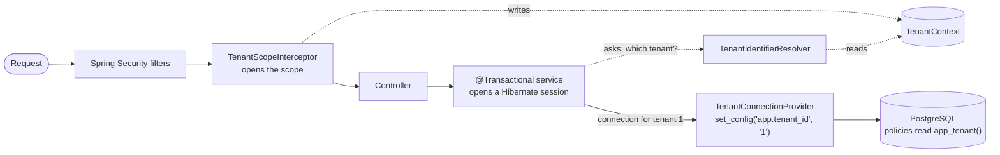
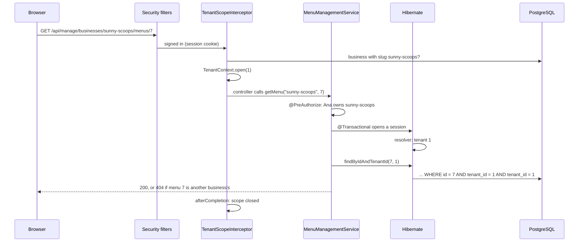

# Tenant isolation

How the marketplace keeps each business's data apart while every business shares one database and one schema. The guide starts with the problem and Hibernate's multi-tenancy concepts, then shows how each piece is wired in here, which tenant every part of the application runs as, how to extend it, and the traps to avoid. The decision itself, a shared schema with a discriminator column, is [ADR 0005](adr/0005-shared-schema-tenant-isolation.md). The tables are in the [domain model](domain-model.md), and permissions in the [security guide](security.md).

## The problem

Every business on the marketplace is a **tenant**: its catalog, menus and schedule are its own. All of them live in the same tables, told apart by a `tenant_id` column holding the business's ID:

| `item.id` | `item.tenant_id` | `item.name` |
|---|---|---|
| 1 | 1 (Sunny Scoops) | Mango sorbet |
| 2 | 2 (Cold Corner) | Lime sorbet |

That is cheap and simple to run, but isolation then depends on every query remembering `WHERE tenant_id = ?`. One query that forgets, say `itemRepository.findById(id)` with an ID taken from the URL, lets an owner read or change another business's item by guessing its ID. That bug has a name, **insecure direct object reference (IDOR)**, and it is one of the most common access control flaws in web applications.

So isolation is built in **layers**, each one catching what the one above misses:

| Layer | Where | What it stops | Since |
|---|---|---|---|
| Permission on the business | `@PreAuthorize` with `BusinessAccess` ([security guide](security.md#per-business-permissions-method-security)) | A user acting on a business they are not a member of | Slice 2b |
| Scoped lookups | `findByIdAndTenantId` in the services | An ID of another business in a URL of your own: answered 404 | Slice 2b |
| **Hibernate tenant filter** | `@TenantId` and `TenantContext` (this guide) | A query that forgets the tenant: Hibernate adds it to every query and every insert | Slice 3a |
| Composite foreign keys | `(id, tenant_id)` references in `V1` ([domain model](domain-model.md#tenant-integrity-enforced-by-the-database)) | A row that mixes two businesses, e.g. one business's item in another's menu | Slice 1a |
| PostgreSQL Row-Level Security | Policies on every tenant-owned table | Anything that bypasses Hibernate: native SQL, a bug in this mechanism | Slice 3b (next) |

The first two are code that has to be written correctly every time. The Hibernate filter is written **once** and applies to every query, including those written in the future by someone who has never read this page.

## Hibernate's multi-tenancy, in four concepts

Hibernate supports three ways to separate tenants: a database per tenant, a schema per tenant, or a shared schema with a **discriminator** column. The project uses the third ([why](adr/0005-shared-schema-tenant-isolation.md)), which Hibernate 6 and later support with one annotation.

- **`@TenantId`** marks the discriminator field of an entity. Hibernate then:
  - adds `tenant_id = ?` to every query on that entity: repository methods, JPQL, `findById`, and joins that fetch it;
  - fills the field on insert with the current tenant, and rejects an insert whose field already holds a different tenant.
- **The tenant identifier** is the value bound to that `?`. Here it is the business's ID, a `Long`, the same type as the field.
- **`CurrentTenantIdentifierResolver`** is how Hibernate asks "which tenant?". The application implements it. Hibernate calls it **once, when a session opens**, and keeps the answer for the whole session: a session cannot change tenant halfway.
- **The root tenant.** The resolver's `isRoot(tenantId)` can declare one identifier special: a session opened with it is not filtered, and an insert keeps the tenant the entity already has. It is Hibernate's own hook for code that must work across tenants, such as an admin task or, here, the public marketplace.

Session is Hibernate's word for what JPA calls the `EntityManager`: the unit of work that loads entities and tracks their changes. With Spring, a `@Transactional` method opens one when the transaction begins and closes it at commit.

## How it is wired in



| Piece | Role |
|---|---|
| `tenant/TenantContext` | The current tenant of the thread, set and restored through scopes |
| `tenant/TenantIdentifierResolver` | Hands `TenantContext` to Hibernate, and declares `CROSS_TENANT` the root tenant |
| `tenant/TenantScopeInterceptor` | Opens a request's scope before the controller and closes it when the request completes |
| `tenant/TenantConfig` | Decides, from the URL, which tenant each request gets |
| `@TenantId` on `Item`, `Menu`, `MenuItem`, `BusinessHours`, `ScheduleException` | Marks the discriminator of every tenant-owned entity |
| `spring.jpa.open-in-view=false` | Makes sessions open with the transaction, after the scope (see below) |
| `tenant/TenantConnectionProvider` | Gives each Hibernate session a connection with its tenant set in PostgreSQL ([Row-Level Security](#row-level-security)) |
| `V4__enable_row_level_security.sql` | The policies, `app_tenant()` and the runtime role's privileges |

### TenantContext: scopes

The current tenant is a `ThreadLocal`, since a servlet request runs on one thread from start to finish. Code never sets it directly: it **opens a scope**, which remembers the previous value and restores it when closed, so scopes nest safely:

```java
try (TenantContext.Scope scope = TenantContext.open(business.getId())) {
  itemRepository.findAll(); // only this business's items
} // the previous tenant is current again
```

The tenant is one of three kinds of value:

| Value | Meaning | Tenant-owned queries | Inserts |
|---|---|---|---|
| A business ID (`> 0`) | Working inside that business | Only its rows | Get that business; another business is rejected |
| `CROSS_TENANT` (`0`) | Hibernate's root tenant: every business at once | Not filtered | Keep the tenant they were given |
| `NONE` (`-1`) | No scope was opened | Find nothing | Rejected |

`NONE` is what makes the design **fail closed**: code that forgets to open a scope sees no business's data, instead of seeing every business's. Tables that belong to no tenant (`business`, `app_user`, `membership`) have no `@TenantId` and work in any scope, which is why sign-in needs no scope at all.

The constraint `ck_business_id CHECK (id > 0)` in `V1` guarantees that `0` and `-1` can never be a real business.

### The resolver

`TenantIdentifierResolver` is three short methods: return `TenantContext.current()`, declare `CROSS_TENANT` the root, and skip a validation that only applies to `getCurrentSession()`, which Spring does not use. It is registered in `application.properties` by class name:

```properties
spring.jpa.properties.hibernate.tenant_identifier_resolver=dev.licaza.itacatl.tenant.TenantIdentifierResolver
```

A Spring bean registered through a `HibernatePropertiesCustomizer` would also work, and is the usual choice when the resolver needs other beans. This one has no dependencies, and the property also reaches test slices such as `@DataJpaTest`, which do not scan components.

### The interceptor and the URL rules

One interceptor runs on every `/api/**` request, and `TenantConfig.tenantOf` picks its tenant from the URL, checked in this order:

| URL | Method | Tenant | Why |
|---|---|---|---|
| `/api/manage/businesses/{slug}/**` | Any | The business with that slug | An owner works on one business at a time |
| `/api/businesses/**`, `/api/menus/**` | `GET`, `HEAD` | `CROSS_TENANT` | The public marketplace lists every business and its published menus |
| Anything else | Any | `NONE` | Sign-in and the current user only read accounts and memberships |

The rules are deliberately narrow:

- **Cross-tenant only for reads.** `CROSS_TENANT` turns the filter off and lets an insert carry any business's ID. A write added under a public path later, such as a customer's reservation in slice 4, gets `NONE` until it is given a scope on purpose.
- **The slug comes from the rule's own pattern**, parsed with Spring's `PathPattern`, not from the controller's `{slug}` variable. A controller that names its variable differently cannot silently change the tenant.
- **One interceptor, one scope per request.** Two interceptors on overlapping paths would each open a scope, and closing them in the wrong order leaves one open.

For management URLs, the slug is looked up (`findBySlug`, one indexed query) and that business's scope is opened. It does not check permissions: `@PreAuthorize` on the service still decides whether this user may work in that business, and an unknown slug stays `NONE`, so the service answers it as before.

`TenantConfig` gets `BusinessRepository` through an `ObjectProvider`, looked up on first use, so web slice tests (`@WebMvcTest`), which load every `WebMvcConfigurer` but no repositories, still start.

A Spring MVC interceptor was chosen over a servlet filter because it runs after Spring has parsed the request path to find the controller, and it is the usual Spring MVC hook for a concern that wraps every handler. Its scope is closed in two places:

- **`afterCompletion`**, which runs even when the controller throws, so a failed request never leaves its tenant on a thread that the server reuses for the next request.
- **`afterConcurrentHandlingStarted`**, for asynchronous requests (server-sent events, `Callable`, `DeferredResult`): the thread is released before the response is complete, and `afterCompletion` would run later on another thread. The async dispatch that completes the request passes through the interceptor again and gets its own scope. Work that runs on an executor in between starts as `NONE` (see [traps](#traps)).

### A management request, step by step



The tenant appears twice in that query: once from the scoped lookup the service writes, once from the filter. The duplication is deliberate: each layer works without the other.

### Why Open Session in View is off

Spring Boot enables **Open Session in View** (OSIV) by default: a Hibernate session opens when the request arrives and stays open until the response is written, so lazy associations can load while JSON is rendered. Here it would open the session **before** the interceptor sets the tenant, and the whole request would run as `NONE`.

It is off (`spring.jpa.open-in-view=false`), which most production guides recommend anyway: a session per transaction holds a database connection only while the service runs, and a lazy load outside a service fails with `LazyInitializationException` instead of quietly sending queries from the web layer. The services already map entities to DTOs inside their transactions, so nothing depended on it.

## Row-Level Security

Hibernate's filter only sees what goes through Hibernate. Native SQL (`JdbcTemplate`, a native query), a bug in the filter, or a future tool connected to the database would all go around it. **Row-Level Security** (RLS) puts the same rule inside PostgreSQL, so it holds whatever sends the query.

### The concepts

- **A policy** is a condition PostgreSQL adds to every statement on a table, much like Hibernate adds `tenant_id = ?`. Once a table has `ENABLE ROW LEVEL SECURITY`, a row is only visible, or writable, if a policy allows it; with no policy, nothing is.
- **`USING`** filters the rows a statement can see: those a `SELECT` returns, and those an `UPDATE` or `DELETE` can touch. Rows outside it are not an error, just invisible: an `UPDATE` of another business's row changes 0 rows.
- **`WITH CHECK`** validates the rows a statement writes: an `INSERT` or `UPDATE` producing a row outside it fails with *new row violates row-level security policy*. Without it, an `UPDATE` could move a row into another business.
- **Policies are permissive by default:** a row passes if *any* policy for that command allows it, so each table has one policy per kind of access.
- **Who is exempt:** superusers, roles with `BYPASSRLS`, and the **table's owner** (unless the table also has `FORCE ROW LEVEL SECURITY`). That is why the application needs a role of its own.
- **A setting carries the tenant.** PostgreSQL does not know the application's users, so the application tells it the tenant with `set_config('app.tenant_id', …)`, a custom setting that lives on the connection, and the policies read it with `current_setting`.

### Two database roles

| Role | Used by | Owns the tables | Policies apply | Privileges |
|---|---|---|---|---|
| The owner (`DB_USER`, `itacatl` locally) | Flyway | Yes | No | Everything, including DDL |
| `itacatl_app` | The application | No | Yes | `SELECT`, `INSERT`, `UPDATE`, `DELETE` on the application's tables, granted in `V4`; no DDL, no access to `flyway_schema_history` |

In `application.properties`, the datasource connects as `itacatl_app` and Flyway as the owner (`spring.flyway.user`, `spring.flyway.password`), so the same deploy migrates with full rights and serves requests with the least. The role cannot `ALTER TABLE … DISABLE ROW LEVEL SECURITY`: only an owner can.

The name `itacatl_app` is fixed, like a table name: it is part of the schema's contract, and the migrations grant it privileges by name. Only its password is a secret (`DB_APP_PASSWORD`), and it never passes through a migration. The role is created **before** the migrations, by whoever creates the database:

| Environment | Who creates `itacatl_app` |
|---|---|
| docker compose | `docker/postgres/create-app-role.sh`, run by the postgres image when its data directory is created |
| Tests | `src/test/resources/testcontainers/create-app-role.sql`, the container's init script |
| AWS | Terraform, when the infrastructure phases are built ([infra plan](infra-plan.md)) |

If it does not exist, `V4` stops with a message saying so, instead of failing on a `GRANT`. In docker compose, `DB_APP_PASSWORD` is required (`${DB_APP_PASSWORD:?…}`): without it, `docker compose up` stops before starting anything, instead of creating the role with an empty password and leaving the backend unable to connect.

### The policies

`V4` defines `app_tenant()`, which reads the setting and turns it into the same values as `TenantContext`. Every tenant-owned table gets two policies:

```sql
CREATE FUNCTION app_tenant() RETURNS BIGINT LANGUAGE sql STABLE AS $$
    SELECT coalesce(nullif(current_setting('app.tenant_id', true), ''), '-1')::BIGINT
$$;

CREATE POLICY item_tenant ON item
    USING (tenant_id = app_tenant())
    WITH CHECK (tenant_id = app_tenant());
CREATE POLICY item_public_read ON item FOR SELECT
    USING (app_tenant() = 0);
```

| `app.tenant_id` | Reads | Writes |
|---|---|---|
| A business ID | Its rows, drafts included | Its rows only, and never into another business |
| `0` (`CROSS_TENANT`) | Every business's rows, but no draft menus and no items of draft menus | None: the public policy is `FOR SELECT` only |
| Unset, empty or `-1` | Nothing | Nothing |

So the database is stricter than Hibernate's root tenant: the marketplace scope can only read, and only what customers may see. A bug in a public endpoint cannot write, and cannot show an owner's unpublished menu.

`business`, `app_user`, `membership` and the session tables have no policies: the business directory is public, and accounts are read when signing in, before any tenant exists.

Deleting a business still cascades to its rows: PostgreSQL runs foreign key actions and checks as the table's owner, without row security, so the composite foreign keys keep working too.

### Passing the tenant to each connection

`TenantConnectionProvider` is Hibernate's `MultiTenantConnectionProvider`: Hibernate asks it for a connection **for a tenant**, passing the same identifier its filter uses, so the two layers can never disagree.

- **On `getConnection(tenant)`** it takes a connection from the pool and runs `SELECT set_config('app.tenant_id', ?, false)`. `false` makes the setting last for the connection's session rather than one transaction, because Hibernate takes the connection before it begins the transaction.
- **On `releaseConnection`** it runs `RESET app.tenant_id` before the connection goes back to the pool, so code that takes pooled connections directly (Spring Session, a `JdbcTemplate` outside any transaction) never inherits a tenant.
- **`getAnyConnection`**, for work outside a session such as reading metadata, sets nothing, so those connections see no business.

It is a Spring bean, registered through a `HibernatePropertiesCustomizer`, because it needs the pool's `DataSource`. A `JdbcTemplate` used inside a `@Transactional` method shares the session's connection, so native SQL in a service gets the tenant too.

Two alternatives were set aside. `SET LOCAL` at the start of each transaction, through a custom transaction manager, resets itself at commit, but works outside Hibernate's model and would read the tenant a second time. A pool-level `connection-init-sql` runs once per physical connection, not per session.

### What it protects against, and what not

Row-Level Security catches **mistakes**: a query without the tenant, native SQL, a wrong scope, a write from the public scope. It does not stop an attacker who can run arbitrary SQL as `itacatl_app`, for instance through SQL injection: they could run `SET app.tenant_id` themselves. That threat is handled where it starts, by never building SQL from input (Spring Data and `JdbcTemplate` bind parameters).

## Which tenant each part runs as

| Caller | Scope | Opened by |
|---|---|---|
| Public marketplace endpoints | `CROSS_TENANT` | `TenantConfig` |
| Management endpoints | The business in the URL | `TenantConfig` |
| Sign-in, current user | `NONE` | Nothing: the default |
| Seed at startup | Each business's own, one transaction per business | `MarketplaceSeeder` |
| Tests | `CROSS_TENANT` | `CrossTenantTestExecutionListener` |
| Requests in HTTP tests | `NONE`, then what `TenantConfig` gives them | `ServerThreadMockMvcConfig` |
| Fixtures of full-application tests | The business they write for | `MarketplaceTestData.inScopeOf` |

The seed writes like a request would: accounts and businesses first, which belong to no tenant, then each business's schedule, catalog and menus in that business's scope and its own transaction. Since Row-Level Security makes the cross-tenant scope read-only, no single scope could write them all.

## Extending it

### A new tenant-owned table

1. Add `tenant_id BIGINT NOT NULL REFERENCES business (id)` and, if other tables point to it, `UNIQUE (id, tenant_id)` for their composite foreign keys ([domain model](domain-model.md#tenant-integrity-enforced-by-the-database)).
2. In the same migration, enable Row-Level Security with the two policies, following `V4`: `<table>_tenant` with `USING` and `WITH CHECK`, and `<table>_public_read` `FOR SELECT` if the marketplace shows it. Then grant `itacatl_app` what it needs (`GRANT SELECT, INSERT, UPDATE, DELETE ON <table> TO itacatl_app`, plus its sequence). Without the grant the application gets *permission denied*, which the full-application tests catch.
3. Annotate the entity's field with `@TenantId`.
4. Keep looking rows up with their tenant in the services (`findByIdAndTenantId`), so the 404 for foreign IDs does not depend on the filter alone.
5. Add cases to `TenantIsolationIntegrationTest` and `RowLevelSecurityIntegrationTest`.

A table that belongs to no business (accounts, sessions, in the future customers' orders across businesses) gets no `@TenantId` and no policies, only its grant. Decide it explicitly: such a table is visible from every scope.

### A new endpoint

Put it under one of the rules in `TenantConfig`. A management endpoint under `/api/manage/businesses/{slug}/` gets its business's scope without any code. A public read under `/api/businesses/` or `/api/menus/` gets `CROSS_TENANT`. Anything else, including a write under the public paths, runs as `NONE` and sees no tenant data: if it needs some, add a rule to `tenantOf`, deliberately, with a case in `TenantConfigTest`, rather than opening a scope inside the controller.

Its HTTP test imports `ServerThreadMockMvcConfig`, so the request runs with the scope it would get in production.

### Work outside a request

A scheduled job (slice 4 expires stock holds with `@Scheduled`) runs on its own thread, with no interceptor, so it starts as `NONE`. It opens a scope per business it works on, **before** calling the transactional service:

```java
for (Long tenantId : tenantIds) {
  try (TenantContext.Scope scope = TenantContext.open(tenantId)) {
    holdService.expireHolds(); // @Transactional: its session opens inside the scope
  }
}
```

### A new cross-tenant read

`CROSS_TENANT` turns the filter off, so the code that runs in it must restrict itself, as the public services do by asking only for `PUBLISHED` menus. The database backs that up, since its public policies hide drafts and allow no writes. Keep it to read-only public data, and prefer adding the endpoint under the public patterns over opening the scope by hand. If the marketplace must not see some rows of a new table, put that condition in its `_public_read` policy too, as `menu` does with its status.

### A new environment

Create `itacatl_app` with a password before the first migration, as `docker/postgres/create-app-role.sh` does, and give the application `DB_APP_PASSWORD`. The owner's credentials (`DB_USER`, `DB_PASSWORD`) are only needed by Flyway.

## Traps

- **The scope must exist before the transaction.** Hibernate asks for the tenant when the session opens, which is when the `@Transactional` method starts. Opening a scope *inside* a transactional method changes nothing for that session. That is why the scope is opened by the interceptor, by the seeder before each business's transaction, and by the test listener before the test transaction.
- **A transaction cannot switch tenant.** A nested `@Transactional` method joins the existing session and its tenant. Only `Propagation.REQUIRES_NEW` opens a new session, which reads the tenant again.
- **New threads start empty.** A `ThreadLocal` is not inherited: `@Async` methods, `CompletableFuture` tasks and executors run as `NONE` unless they open a scope. The same holds for virtual threads.
- **Always close a scope.** Use try-with-resources. A scope left open on a pooled thread would hand its tenant to whichever request that thread serves next.
- **The root tenant trusts the entity, the database does not.** In `CROSS_TENANT`, Hibernate lets an insert keep the `tenantId` it was given, but Row-Level Security rejects every write from that scope. Only slice tests, which connect as the owner, write that way; everything else writes in the business's scope.
- **Native SQL sees the tenant only inside a transaction.** `JdbcTemplate` goes around Hibernate's filter. Inside a `@Transactional` method it shares the session's connection and Row-Level Security applies with that tenant; outside one it takes a pooled connection with no tenant and sees no business.
- **MockMvc runs requests on the test's thread.** That thread is in `CROSS_TENANT`, so without `ServerThreadMockMvcConfig` an endpoint that no rule covers would see every business in tests and nothing in production.
- **Slice tests do not exercise Row-Level Security.** `@DataJpaTest` connects as the owner, whom the policies do not apply to. Only the full-application tests (`AppRoleTestcontainersConfiguration`) connect as `itacatl_app`.
- **`@ServiceConnection` would connect the application as the owner.** Spring Boot builds both the datasource's and Flyway's connection from the container. `AppRoleTestcontainersConfiguration` limits it to Flyway (`@ServiceConnection(type = FlywayConnectionDetails.class)`) and sets the datasource to `itacatl_app` itself.
- **The role is created once per database.** The postgres image runs its init scripts only when the data directory is empty: a database created before `DB_APP_PASSWORD` was set keeps a role without a usable password, and needs `docker compose down -v`.
- **A failed connection can look like something else.** When `itacatl_app` cannot sign in, Spring Boot fails at startup with *Failed to determine DatabaseDriver* from Spring Session's initializer, the first bean that opens a connection. Check the role and `DB_APP_PASSWORD` first.

## Known limitations

- **The slug is resolved more than once per management request:** by the interceptor, by `BusinessAccess` for the permission, and by the service, which needs the business itself (its time zone, for instance). Each is one indexed query. Passing the business from the interceptor to the service would save them, at the cost of services that depend on a request attribute instead of their arguments.
- **The seed is not atomic.** Each business is its own transaction, so a business whose data fails leaves the ones before it in place, and the next start skips the seed because businesses exist. The seed only runs on demo databases, which are recreated after fixing the file.
- **A failed reset leaves the tenant on a pooled connection.** If `RESET app.tenant_id` fails, the connection still goes back to the pool. The next Hibernate session overwrites the value; code that takes the connection directly would inherit it until then. A connection that fails a statement is usually broken and discarded by the pool, and the failure is logged.

## Tests

| Test | What it proves |
|---|---|
| `TenantIsolationIntegrationTest` | In a business's scope, repositories see only its rows, also through `findById` and queries that do not mention the tenant; new rows get that business and rows of another are rejected; `NONE` sees no tenant rows but still sees businesses; `CROSS_TENANT` sees all. Over HTTP, requests that start as `NONE` get the right scope from the interceptor, and leave the thread as they found it |
| `RowLevelSecurityIntegrationTest` | With native SQL as `itacatl_app`: a business sees only its rows, cannot write or move rows into another, `CROSS_TENANT` reads every business but no drafts and cannot write, no tenant sees nothing (also on a connection taken from the pool directly), and the role is not an owner, has no `BYPASSRLS` and cannot disable the policies |
| `TenantConfigTest` | The URL rules: marketplace reads are cross-tenant, writes under public paths get `NONE`, management URLs get their business, unknown slugs and other URLs get `NONE` |
| `TenantScopeInterceptorTest` | A completed request, and an async one that releases its thread, leave the thread without their tenant |
| `TenantContextTest` | Scopes nest and restore the previous tenant; a scope is invisible to other threads |
| `TenantIntegrityIntegrationTest` | The composite foreign keys reject rows that mix businesses |
| `MenuManagementServiceIntegrationTest`, `CatalogServiceIntegrationTest` | The scoped lookups: another business's ID is a 404 |

The tests connect in two ways:

| Tests | Database role | Configuration | Fixtures |
|---|---|---|---|
| Slices (`@DataJpaTest`) | The owner: no Row-Level Security | `TestcontainersConfiguration` | Several businesses in one test transaction, in `CROSS_TENANT` |
| Full application (`@SpringBootTest`) | `itacatl_app`, like production | `AppRoleTestcontainersConfiguration` | Each business's rows in its own scope (`inScopeOf`), since `CROSS_TENANT` cannot write |

Every Spring test starts in `CROSS_TENANT` (`CrossTenantTestExecutionListener`, registered in `src/test/resources/META-INF/spring.factories`). The full-application tests are not `@Transactional`, so each repository call opens its own session in the scope current at that moment, as a request does. Their MockMvc requests run on the test's thread, so the HTTP tests import `ServerThreadMockMvcConfig`, a filter that starts each request as `NONE`, as on a server thread.
